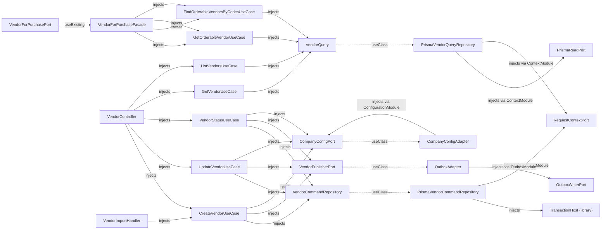
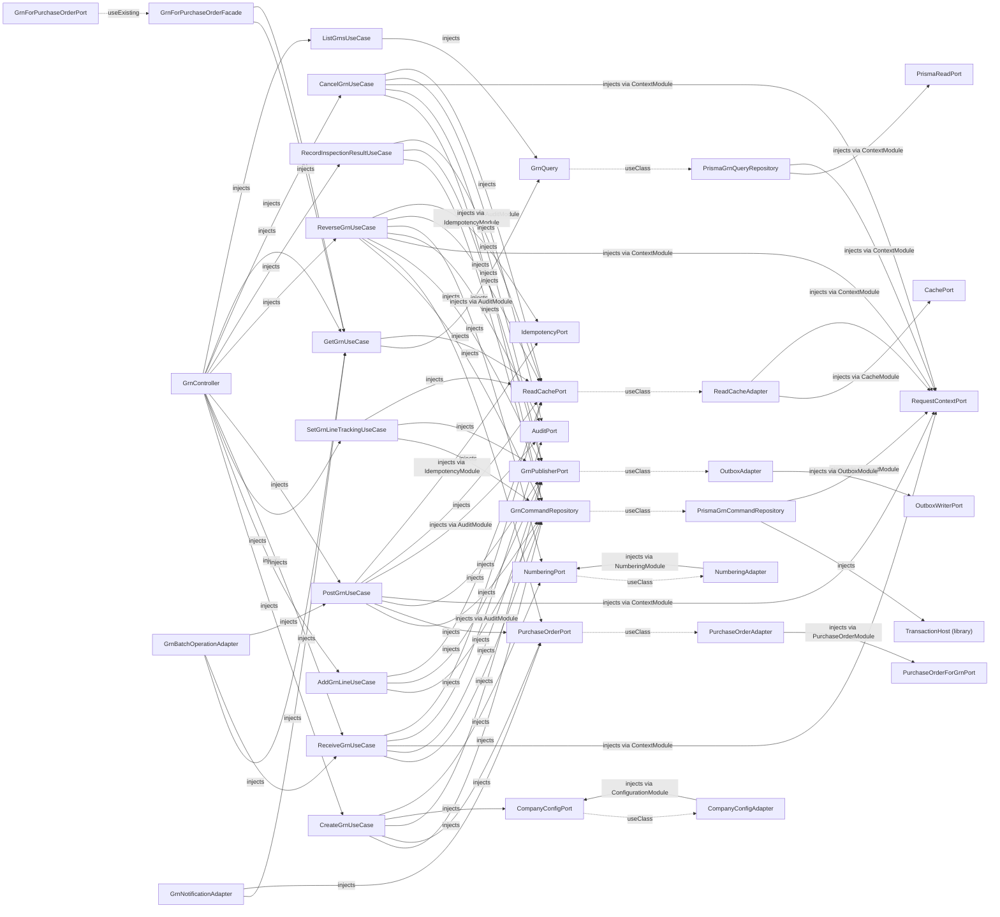
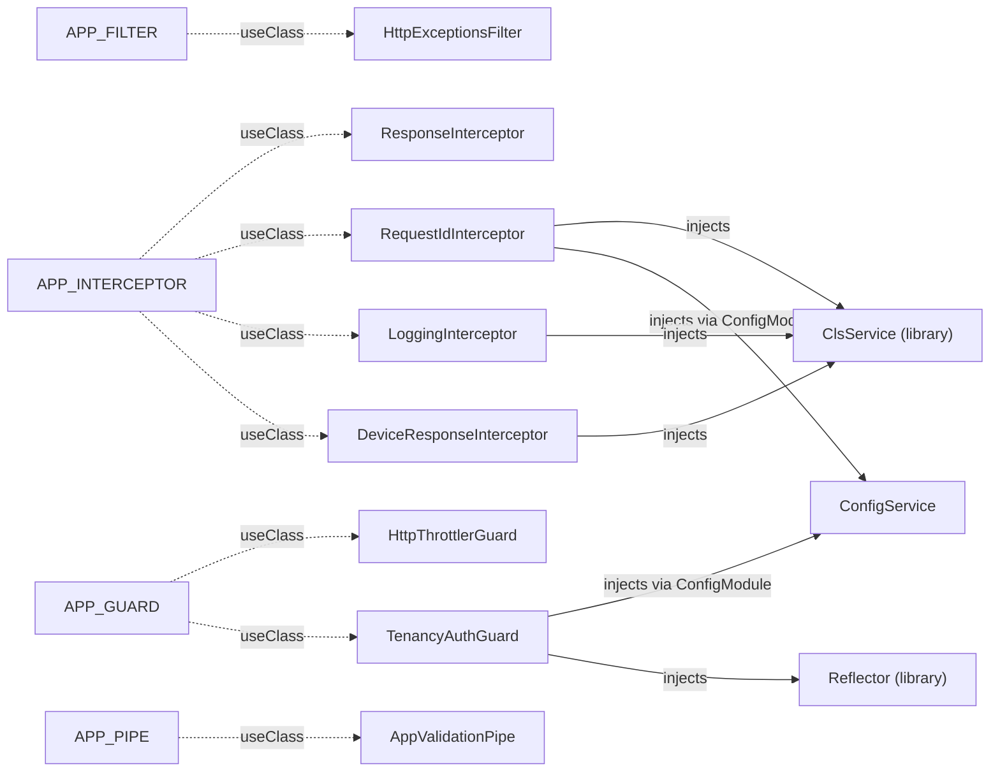

# DI Wiring — who injects whom, which token binds to which implementation

**Generated** by `scripts/generate-di-wiring.mjs` (`npm run docs:di`) from real source:
`@Module` provider bindings + every constructor, with each dependency resolved through the
consuming file's own imports — so module-local tokens (each module's own `CompanyConfigPort` /
`NumberingPort`) are attributed to the right module, and only genuinely cross-boundary edges
appear. Blocks are validated for mermaid-safe syntax at generation time.

- solid `-->|injects|` — constructor dependency
- dashed `-.->` — Nest binding declared in the module (`useClass` / `useExisting`)
- `TransactionHost / Queue / AmqpConnection …` — library providers (write TX host, BullMQ, brokers)
- `injects via OwnerModule` — the token is provided by a DIFFERENT module (cross-boundary)
- `XModule bootstrap` — what the module class injects to register opt-in handlers

---

## Cross-module graph (Nest imports + token ownership)

```mermaid
flowchart LR
    AppModule["AppModule"]
    ConfigModule["ConfigModule"]
    AppModule -->|ConfigService| ConfigModule
    VendorModule["VendorModule"]
    ContextModule__src_platform_platform_common_context_["ContextModule (src/platform/platform-common/context)"]
    ContextModule__src_platform_platform_common_context__2["ContextModule__src_platform_platform_common_context_"]
    VendorModule -->|RequestContextPort, PrismaReadPort| ContextModule__src_platform_platform_common_context__2
    OutboxModule["OutboxModule"]
    VendorModule -->|OutboxWriterPort| OutboxModule
    ConfigurationModule["ConfigurationModule"]
    VendorModule -->|CompanyConfigPort| ConfigurationModule
    GoodReceiptNoteModule["GoodReceiptNoteModule"]
    GoodReceiptNoteModule -->|RequestContextPort, PrismaReadPort| ContextModule__src_platform_platform_common_context__2
    AuditModule["AuditModule"]
    GoodReceiptNoteModule -->|AuditPort| AuditModule
    IdempotencyModule["IdempotencyModule"]
    GoodReceiptNoteModule -->|IdempotencyPort| IdempotencyModule
    GoodReceiptNoteModule -->|OutboxWriterPort| OutboxModule
    GoodReceiptNoteModule -->|CompanyConfigPort| ConfigurationModule
    PurchaseOrderModule["PurchaseOrderModule"]
    GoodReceiptNoteModule -->|PurchaseOrderForGrnPort| PurchaseOrderModule
    NumberingModule["NumberingModule"]
    GoodReceiptNoteModule -->|NumberingPort| NumberingModule
    CacheModule["CacheModule"]
    GoodReceiptNoteModule -->|CachePort| CacheModule
    ProductModule["ProductModule"]
    ProductModule -->|RequestContextPort, PrismaReadPort| ContextModule__src_platform_platform_common_context__2
    ProductModule -->|OutboxWriterPort| OutboxModule
    ProductModule -->|CompanyConfigPort| ConfigurationModule
    PurchaseOrderModule -->|RequestContextPort, PrismaReadPort| ContextModule__src_platform_platform_common_context__2
    PurchaseOrderModule -->|AuditPort| AuditModule
    RecurringModule["RecurringModule"]
    PurchaseOrderModule -->|RecurringTemplatePort, RecurringExecutionPort| RecurringModule
    ObservabilityModule["ObservabilityModule"]
    PurchaseOrderModule -->|LoggerPort| ObservabilityModule
    InboxModule["InboxModule"]
    PurchaseOrderModule -->|InboxPort| InboxModule
    PurchaseOrderModule -->|OutboxWriterPort| OutboxModule
    PurchaseOrderModule -->|CompanyConfigPort| ConfigurationModule
    PurchaseOrderModule -->|NumberingPort| NumberingModule
    PurchaseOrderModule -->|CachePort| CacheModule
    PurchaseOrderModule -->|ProductForPurchasePort| ProductModule
    PurchaseOrderModule -->|VendorForPurchasePort| VendorModule
    InvoiceModule["InvoiceModule"]
    InvoiceModule -->|RecurringExecutionPort| RecurringModule
    InvoiceModule -->|LoggerPort| ObservabilityModule
    InvoiceModule -->|RequestContextPort, PrismaReadPort| ContextModule__src_platform_platform_common_context__2
    InvoiceModule -->|InboxPort| InboxModule
    InvoiceModule -->|OutboxWriterPort| OutboxModule
    InvoiceModule -->|CompanyConfigPort| ConfigurationModule
    InvoiceModule -->|NumberingPort| NumberingModule
    PrismaModule["PrismaModule"]
    PrismaModule -->|ConfigService| ConfigModule
    MessagingModule__src_infrastructure_messaging_["MessagingModule (src/infrastructure/messaging)"]
    MessagingModule__src_infrastructure_messaging__2["MessagingModule__src_infrastructure_messaging_"]
    MessagingModule__src_infrastructure_messaging__2 -->|ConfigService| ConfigModule
    NotificationModule__src_infrastructure_notification_["NotificationModule (src/infrastructure/notification)"]
    NotificationModule__src_infrastructure_notification__2["NotificationModule__src_infrastructure_notification_"]
    NotificationModule__src_infrastructure_notification__2 -->|ConfigService| ConfigModule
    RedisModule["RedisModule"]
    RedisModule -->|ConfigService| ConfigModule
    AuditModule -->|RequestContextPort| ContextModule__src_platform_platform_common_context__2
    BatchOperationModule["BatchOperationModule"]
    BatchOperationModule -->|OutboxWriterPort| OutboxModule
    BatchOperationModule -->|ConfigService| ConfigModule
    BatchOperationModule -->|NumberingPort| NumberingModule
    BatchOperationModule -->|RequestContextPort| ContextModule__src_platform_platform_common_context__2
    BatchOperationModule -->|AuditPort| AuditModule
    CacheModule -->|ConfigService| ConfigModule
    CacheModule -->|RedisService| RedisModule
    CacheModule -->|RequestContextPort| ContextModule__src_platform_platform_common_context__2
    ContextModule__src_platform_platform_common_context__2 -->|ConfigService| ConfigModule
    ContextModule__src_platform_platform_common_context__2 -->|PrismaWriteService| PrismaModule
    IdempotencyModule -->|PrismaWriteService| PrismaModule
    IdempotencyModule -->|ConfigService| ConfigModule
    IdempotencyModule -->|RedisService| RedisModule
    IdempotencyModule -->|RequestContextPort| ContextModule__src_platform_platform_common_context__2
    ImportModule["ImportModule"]
    ImportModule -->|OutboxWriterPort| OutboxModule
    ImportModule -->|ConfigService| ConfigModule
    StorageModule__src_platform_platform_common_storage_["StorageModule (src/platform/platform-common/storage)"]
    StorageModule__src_platform_platform_common_storage__2["StorageModule__src_platform_platform_common_storage_"]
    ImportModule -->|FileStoragePort| StorageModule__src_platform_platform_common_storage__2
    ImportModule -->|RequestContextPort| ContextModule__src_platform_platform_common_context__2
    ImportModule -->|NumberingPort| NumberingModule
    ImportModule -->|AuditPort| AuditModule
    InboxModule -->|ConfigService| ConfigModule
    LockingModule["LockingModule"]
    LockingModule -->|RedisService| RedisModule
    LockingModule -->|ConfigService| ConfigModule
    MessagingModule__src_platform_platform_common_messaging_["MessagingModule (src/platform/platform-common/messaging)"]
    MessagingModule__src_platform_platform_common_messaging__2["MessagingModule__src_platform_platform_common_messaging_"]
    MessagingModule__src_platform_platform_common_messaging__2 -->|ConfigService| ConfigModule
    NotificationModule__src_platform_platform_common_notification_["NotificationModule (src/platform/platform-common/notification)"]
    NotificationModule__src_platform_platform_common_notification__2["NotificationModule__src_platform_platform_common_notification_"]
    NotificationModule__src_platform_platform_common_notification__2 -->|RequestContextPort| ContextModule__src_platform_platform_common_context__2
    NotificationModule__src_platform_platform_common_notification__2 -->|OutboxWriterPort| OutboxModule
    NotificationModule__src_platform_platform_common_notification__2 -->|ConfigService| ConfigModule
    NotificationModule__src_platform_platform_common_notification__2 -->|LoggerPort| ObservabilityModule
    NumberingModule -->|RequestContextPort| ContextModule__src_platform_platform_common_context__2
    ObservabilityModule -->|ConfigService| ConfigModule
    OutboxModule -->|RequestContextPort| ContextModule__src_platform_platform_common_context__2
    OutboxModule -->|MessageQueuePort| MessagingModule__src_platform_platform_common_messaging__2
    EventsModule["EventsModule"]
    OutboxModule -->|InProcessEventBus| EventsModule
    OutboxModule -->|ConfigService| ConfigModule
    RecurringModule -->|OutboxWriterPort| OutboxModule
    SchedulerModule["SchedulerModule"]
    RecurringModule -->|SchedulerPort, ScheduledJobHandlerRegistry| SchedulerModule
    ConditionEngineModule["ConditionEngineModule"]
    RecurringModule -->|ConditionEvaluator| ConditionEngineModule
    RecurringModule -->|RequestContextPort| ContextModule__src_platform_platform_common_context__2
    RecurringModule -->|AuditPort| AuditModule
    SchedulerModule -->|ConfigService| ConfigModule
    SchedulerModule -->|MessageQueuePort| MessagingModule__src_platform_platform_common_messaging__2
    SchedulerModule -->|RequestContextPort| ContextModule__src_platform_platform_common_context__2
    SchedulerModule -->|AuditPort| AuditModule
    SchedulerModule -->|DistributedLockPort| LockingModule
    WebhookModule["WebhookModule"]
    WebhookModule -->|RequestContextPort| ContextModule__src_platform_platform_common_context__2
    WebhookModule -->|ConfigService| ConfigModule
    WebhookModule -->|OutboxWriterPort| OutboxModule
    WebhookModule -->|IdempotencyPort| IdempotencyModule
    ConfigurationModule -->|ConfigService| ConfigModule
    ConfigurationModule -->|RequestContextPort| ContextModule__src_platform_platform_common_context__2
    SagaModule["SagaModule"]
    SagaModule -->|OutboxWriterPort| OutboxModule
    SagaModule -->|ConfigService| ConfigModule
    SagaModule -->|RequestContextPort| ContextModule__src_platform_platform_common_context__2
```

---

## Per-module wiring

### Business — party/vendor

#### VendorModule — `src/business/party/vendor/vendor.module.ts`

imports: PlatformModule · exports: VendorForPurchasePort

### Business — procurement

#### GoodReceiptNoteModule — `src/business/procurement/good-receipt-note/good-receipt-note.module.ts`

imports: PlatformModule, PurchaseOrderModule · exports: GrnForPurchaseOrderPort

#### PurchaseOrderModule — `src/business/procurement/purchase-order/purchase-order.module.ts`

imports: PlatformModule, ProductModule, VendorModule · exports: PurchaseOrderForGrnPort

```mermaid
flowchart LR
    PurchaseOrderForGrnPort["PurchaseOrderForGrnPort"]
    PurchaseOrderForGrnFacade["PurchaseOrderForGrnFacade"]
    PurchaseOrderForGrnPort -.->|useExisting| PurchaseOrderForGrnFacade
    PurchaseOrderCommandRepository["PurchaseOrderCommandRepository"]
    PrismaPurchaseOrderCommandRepository["PrismaPurchaseOrderCommandRepository"]
    PurchaseOrderCommandRepository -.->|useClass| PrismaPurchaseOrderCommandRepository
    PurchaseOrderQuery["PurchaseOrderQuery"]
    PrismaPurchaseOrderQueryRepository["PrismaPurchaseOrderQueryRepository"]
    PurchaseOrderQuery -.->|useClass| PrismaPurchaseOrderQueryRepository
    PurchaseOrderPublisherPort["PurchaseOrderPublisherPort"]
    OutboxAdapter["OutboxAdapter"]
    PurchaseOrderPublisherPort -.->|useClass| OutboxAdapter
    CompanyConfigPort["CompanyConfigPort"]
    CompanyConfigAdapter["CompanyConfigAdapter"]
    CompanyConfigPort -.->|useClass| CompanyConfigAdapter
    NumberingPort["NumberingPort"]
    NumberingAdapter["NumberingAdapter"]
    NumberingPort -.->|useClass| NumberingAdapter
    ReadCachePort["ReadCachePort"]
    ReadCacheAdapter["ReadCacheAdapter"]
    ReadCachePort -.->|useClass| ReadCacheAdapter
    PurchasableProductPort["PurchasableProductPort"]
    PurchasableProductAdapter["PurchasableProductAdapter"]
    PurchasableProductPort -.->|useClass| PurchasableProductAdapter
    OrderableVendorPort["OrderableVendorPort"]
    OrderableVendorAdapter["OrderableVendorAdapter"]
    OrderableVendorPort -.->|useClass| OrderableVendorAdapter
    PurchaseOrderController["PurchaseOrderController"]
    CreatePurchaseOrderUseCase["CreatePurchaseOrderUseCase"]
    PurchaseOrderController -->|injects| CreatePurchaseOrderUseCase
    AddPurchaseOrderLineUseCase["AddPurchaseOrderLineUseCase"]
    PurchaseOrderController -->|injects| AddPurchaseOrderLineUseCase
    UpdatePurchaseOrderUseCase["UpdatePurchaseOrderUseCase"]
    PurchaseOrderController -->|injects| UpdatePurchaseOrderUseCase
    UpdatePurchaseOrderLineUseCase["UpdatePurchaseOrderLineUseCase"]
    PurchaseOrderController -->|injects| UpdatePurchaseOrderLineUseCase
    RemovePurchaseOrderLineUseCase["RemovePurchaseOrderLineUseCase"]
    PurchaseOrderController -->|injects| RemovePurchaseOrderLineUseCase
    GetPurchaseOrderReceiptsUseCase["GetPurchaseOrderReceiptsUseCase"]
    PurchaseOrderController -->|injects| GetPurchaseOrderReceiptsUseCase
    GetPurchaseOrderRemainingQuantitiesUseCase["GetPurchaseOrderRemainingQuantitiesUseCase"]
    PurchaseOrderController -->|injects| GetPurchaseOrderRemainingQuantitiesUseCase
    PurchaseOrderTransitionUseCase["PurchaseOrderTransitionUseCase"]
    PurchaseOrderController -->|injects| PurchaseOrderTransitionUseCase
    AmendPurchaseOrderUseCase["AmendPurchaseOrderUseCase"]
    PurchaseOrderController -->|injects| AmendPurchaseOrderUseCase
    IssuePurchaseOrderUseCase["IssuePurchaseOrderUseCase"]
    PurchaseOrderController -->|injects| IssuePurchaseOrderUseCase
    ClosePurchaseOrderUseCase["ClosePurchaseOrderUseCase"]
    PurchaseOrderController -->|injects| ClosePurchaseOrderUseCase
    GetPurchaseOrderUseCase["GetPurchaseOrderUseCase"]
    PurchaseOrderController -->|injects| GetPurchaseOrderUseCase
    ListPurchaseOrdersUseCase["ListPurchaseOrdersUseCase"]
    PurchaseOrderController -->|injects| ListPurchaseOrdersUseCase
    CreateRecurringPurchaseOrderUseCase["CreateRecurringPurchaseOrderUseCase"]
    PurchaseOrderController -->|injects| CreateRecurringPurchaseOrderUseCase
    CreateRecurringFromPurchaseOrderUseCase["CreateRecurringFromPurchaseOrderUseCase"]
    PurchaseOrderController -->|injects| CreateRecurringFromPurchaseOrderUseCase
    PurchaseOrderBatchOperationAdapter["PurchaseOrderBatchOperationAdapter"]
    PurchaseOrderBatchOperationAdapter -->|injects| GetPurchaseOrderUseCase
    PurchaseOrderBatchOperationAdapter -->|injects| PurchaseOrderTransitionUseCase
    PurchaseOrderNotificationAdapter["PurchaseOrderNotificationAdapter"]
    PurchaseOrderNotificationAdapter -->|injects| GetPurchaseOrderUseCase
    PurchaseOrderNotificationAdapter -->|injects| OrderableVendorPort
    PurchaseOrderImportHandler["PurchaseOrderImportHandler"]
    PurchaseOrderImportHandler -->|injects| OrderableVendorPort
    PurchaseOrderImportHandler -->|injects| PurchasableProductPort
    ImportPurchaseOrderUseCase["ImportPurchaseOrderUseCase"]
    PurchaseOrderImportHandler -->|injects| ImportPurchaseOrderUseCase
    CreatePurchaseOrderUseCase -->|injects| PurchaseOrderCommandRepository
    CreatePurchaseOrderUseCase -->|injects| OrderableVendorPort
    CreatePurchaseOrderUseCase -->|injects| PurchaseOrderPublisherPort
    CreatePurchaseOrderUseCase -->|injects| CompanyConfigPort
    CreatePurchaseOrderUseCase -->|injects| NumberingPort
    RequestContextPort["RequestContextPort"]
    CreatePurchaseOrderUseCase -->|injects via ContextModule| RequestContextPort
    ImportPurchaseOrderUseCase -->|injects| PurchaseOrderCommandRepository
    ImportPurchaseOrderUseCase -->|injects| CompanyConfigPort
    ImportPurchaseOrderUseCase -->|injects| OrderableVendorPort
    ImportPurchaseOrderUseCase -->|injects| NumberingPort
    ImportPurchaseOrderUseCase -->|injects via ContextModule| RequestContextPort
    ImportPurchaseOrderUseCase -->|injects| PurchaseOrderPublisherPort
    ImportPurchaseOrderUseCase -->|injects| ReadCachePort
    AddPurchaseOrderLineUseCase -->|injects| PurchaseOrderCommandRepository
    AddPurchaseOrderLineUseCase -->|injects| PurchasableProductPort
    AddPurchaseOrderLineUseCase -->|injects| PurchaseOrderPublisherPort
    AddPurchaseOrderLineUseCase -->|injects| CompanyConfigPort
    AddPurchaseOrderLineUseCase -->|injects| ReadCachePort
    UpdatePurchaseOrderUseCase -->|injects| PurchaseOrderCommandRepository
    UpdatePurchaseOrderUseCase -->|injects| PurchaseOrderPublisherPort
    UpdatePurchaseOrderUseCase -->|injects| ReadCachePort
    UpdatePurchaseOrderLineUseCase -->|injects| PurchaseOrderCommandRepository
    UpdatePurchaseOrderLineUseCase -->|injects| PurchasableProductPort
    UpdatePurchaseOrderLineUseCase -->|injects| PurchaseOrderPublisherPort
    UpdatePurchaseOrderLineUseCase -->|injects| CompanyConfigPort
    UpdatePurchaseOrderLineUseCase -->|injects| ReadCachePort
    RemovePurchaseOrderLineUseCase -->|injects| PurchaseOrderCommandRepository
    RemovePurchaseOrderLineUseCase -->|injects| PurchaseOrderPublisherPort
    RemovePurchaseOrderLineUseCase -->|injects| CompanyConfigPort
    RemovePurchaseOrderLineUseCase -->|injects| ReadCachePort
    PurchaseOrderTransitionUseCase -->|injects| PurchaseOrderCommandRepository
    PurchaseOrderTransitionUseCase -->|injects| PurchaseOrderPublisherPort
    PurchaseOrderTransitionUseCase -->|injects| CompanyConfigPort
    PurchaseOrderTransitionUseCase -->|injects| PurchaseOrderQuery
    PurchaseOrderTransitionUseCase -->|injects via ContextModule| RequestContextPort
    AuditPort["AuditPort"]
    PurchaseOrderTransitionUseCase -->|injects via AuditModule| AuditPort
    PurchaseOrderTransitionUseCase -->|injects| ReadCachePort
    AmendPurchaseOrderUseCase -->|injects| PurchaseOrderCommandRepository
    AmendPurchaseOrderUseCase -->|injects| PurchaseOrderPublisherPort
    AmendPurchaseOrderUseCase -->|injects via ContextModule| RequestContextPort
    AmendPurchaseOrderUseCase -->|injects via AuditModule| AuditPort
    AmendPurchaseOrderUseCase -->|injects| ReadCachePort
    IssuePurchaseOrderUseCase -->|injects| PurchaseOrderCommandRepository
    IssuePurchaseOrderUseCase -->|injects| PurchaseOrderPublisherPort
    IssuePurchaseOrderUseCase -->|injects via ContextModule| RequestContextPort
    IssuePurchaseOrderUseCase -->|injects via AuditModule| AuditPort
    IssuePurchaseOrderUseCase -->|injects| ReadCachePort
    ClosePurchaseOrderUseCase -->|injects| PurchaseOrderCommandRepository
    ClosePurchaseOrderUseCase -->|injects| PurchaseOrderPublisherPort
    ClosePurchaseOrderUseCase -->|injects via ContextModule| RequestContextPort
    ClosePurchaseOrderUseCase -->|injects via AuditModule| AuditPort
    ClosePurchaseOrderUseCase -->|injects| ReadCachePort
    RegisterPurchaseOrderReceiptUseCase["RegisterPurchaseOrderReceiptUseCase"]
    RegisterPurchaseOrderReceiptUseCase -->|injects| PurchaseOrderCommandRepository
    RegisterPurchaseOrderReceiptUseCase -->|injects| CompanyConfigPort
    RegisterPurchaseOrderReceiptUseCase -->|injects| ReadCachePort
    HasPurchaseOrderReceiptsUseCase["HasPurchaseOrderReceiptsUseCase"]
    HasPurchaseOrderReceiptsUseCase -->|injects| PurchaseOrderQuery
    GetPurchaseOrderUseCase -->|injects| PurchaseOrderQuery
    GetPurchaseOrderUseCase -->|injects| ReadCachePort
    GetPurchaseOrderReceiptsUseCase -->|injects| PurchaseOrderQuery
    GetPurchaseOrderRemainingQuantitiesUseCase -->|injects| PurchaseOrderQuery
    ListPurchaseOrdersUseCase -->|injects| PurchaseOrderQuery
    CreateRecurringPurchaseOrderUseCase -->|injects| OrderableVendorPort
    CreateRecurringPurchaseOrderUseCase -->|injects| NumberingPort
    RecurringTemplatePort["RecurringTemplatePort"]
    CreateRecurringPurchaseOrderUseCase -->|injects via RecurringModule| RecurringTemplatePort
    CreateRecurringPurchaseOrderUseCase -->|injects via ContextModule| RequestContextPort
    CreateRecurringFromPurchaseOrderUseCase -->|injects| PurchaseOrderQuery
    CreateRecurringFromPurchaseOrderUseCase -->|injects| NumberingPort
    CreateRecurringFromPurchaseOrderUseCase -->|injects via RecurringModule| RecurringTemplatePort
    CreateRecurringFromPurchaseOrderUseCase -->|injects via ContextModule| RequestContextPort
    GenerateRecurringPurchaseOrderUseCase["GenerateRecurringPurchaseOrderUseCase"]
    GenerateRecurringPurchaseOrderUseCase -->|injects| CreatePurchaseOrderUseCase
    GenerateRecurringPurchaseOrderUseCase -->|injects| AddPurchaseOrderLineUseCase
    GenerateRecurringPurchaseOrderUseCase -->|injects| GetPurchaseOrderUseCase
    GenerateRecurringPurchaseOrderUseCase -->|injects| PurchaseOrderTransitionUseCase
    RecurringExecutionPort["RecurringExecutionPort"]
    GenerateRecurringPurchaseOrderUseCase -->|injects via RecurringModule| RecurringExecutionPort
    LoggerPort["LoggerPort"]
    GenerateRecurringPurchaseOrderUseCase -->|injects via ObservabilityModule| LoggerPort
    GenerateRecurringPurchaseOrderUseCase -->|injects via ContextModule| RequestContextPort
    RecurringOccurrenceRequestedRabbitMQListener["RecurringOccurrenceRequestedRabbitMQListener"]
    RecurringOccurrenceRequestedRabbitMQListener -->|injects| GenerateRecurringPurchaseOrderUseCase
    InboxPort["InboxPort"]
    RecurringOccurrenceRequestedRabbitMQListener -->|injects via InboxModule| InboxPort
    RecurringOccurrenceRequestedRabbitMQListener -->|injects via ContextModule| RequestContextPort
    GoodsReceiptPostedListener["GoodsReceiptPostedListener"]
    GoodsReceiptPostedListener -->|injects via InboxModule| InboxPort
    GoodsReceiptPostedListener -->|injects| RegisterPurchaseOrderReceiptUseCase
    GoodsReceiptPostedListener -->|injects via ContextModule| RequestContextPort
    PurchaseOrderForGrnFacade -->|injects| GetPurchaseOrderUseCase
    PurchaseOrderForGrnFacade -->|injects| RegisterPurchaseOrderReceiptUseCase
    PurchaseOrderForGrnFacade -->|injects| HasPurchaseOrderReceiptsUseCase
    PurchaseOrderForGrnFacade -->|injects| GetPurchaseOrderUseCase
    PurchaseOrderForGrnFacade -->|injects| RegisterPurchaseOrderReceiptUseCase
    PurchaseOrderForGrnFacade -->|injects| HasPurchaseOrderReceiptsUseCase
    TransactionHost__library_["TransactionHost (library)"]
    PrismaPurchaseOrderCommandRepository -->|injects| TransactionHost__library_
    PrismaPurchaseOrderCommandRepository -->|injects via ContextModule| RequestContextPort
    PrismaReadPort["PrismaReadPort"]
    PrismaPurchaseOrderQueryRepository -->|injects via ContextModule| PrismaReadPort
    PrismaPurchaseOrderQueryRepository -->|injects via ContextModule| RequestContextPort
    OutboxWriterPort["OutboxWriterPort"]
    OutboxAdapter -->|injects via OutboxModule| OutboxWriterPort
    CompanyConfigAdapter -->|injects via ConfigurationModule| CompanyConfigPort
    NumberingAdapter -->|injects via NumberingModule| NumberingPort
    CachePort["CachePort"]
    ReadCacheAdapter -->|injects via CacheModule| CachePort
    ReadCacheAdapter -->|injects via ContextModule| RequestContextPort
    ProductForPurchasePort["ProductForPurchasePort"]
    PurchasableProductAdapter -->|injects via ProductModule| ProductForPurchasePort
    VendorForPurchasePort["VendorForPurchasePort"]
    OrderableVendorAdapter -->|injects via VendorModule| VendorForPurchasePort
```

### Business — sales/invoice

#### InvoiceModule — `src/business/sales/invoice/invoice.module.ts`

imports: PlatformModule · exports: InvoiceForReportsPort

```mermaid
flowchart LR
    InvoiceForReportsPort["InvoiceForReportsPort"]
    InvoiceForReportsFacade["InvoiceForReportsFacade"]
    InvoiceForReportsPort -.->|useExisting| InvoiceForReportsFacade
    InvoiceCommandRepository["InvoiceCommandRepository"]
    PrismaInvoiceCommandRepository["PrismaInvoiceCommandRepository"]
    InvoiceCommandRepository -.->|useClass| PrismaInvoiceCommandRepository
    InvoiceQuery["InvoiceQuery"]
    PrismaInvoiceQueryRepository["PrismaInvoiceQueryRepository"]
    InvoiceQuery -.->|useClass| PrismaInvoiceQueryRepository
    InvoicePublisherPort["InvoicePublisherPort"]
    OutboxAdapter["OutboxAdapter"]
    InvoicePublisherPort -.->|useClass| OutboxAdapter
    CompanyConfigPort["CompanyConfigPort"]
    CompanyConfigAdapter["CompanyConfigAdapter"]
    CompanyConfigPort -.->|useClass| CompanyConfigAdapter
    NumberingPort["NumberingPort"]
    NumberingAdapter["NumberingAdapter"]
    NumberingPort -.->|useClass| NumberingAdapter
    InvoiceController["InvoiceController"]
    CreateInvoiceUseCase["CreateInvoiceUseCase"]
    InvoiceController -->|injects| CreateInvoiceUseCase
    PostInvoiceUseCase["PostInvoiceUseCase"]
    InvoiceController -->|injects| PostInvoiceUseCase
    GetInvoiceUseCase["GetInvoiceUseCase"]
    InvoiceController -->|injects| GetInvoiceUseCase
    ListInvoicesUseCase["ListInvoicesUseCase"]
    InvoiceController -->|injects| ListInvoicesUseCase
    CreateInvoiceUseCase -->|injects| InvoiceCommandRepository
    CreateInvoiceUseCase -->|injects| InvoicePublisherPort
    CreateInvoiceUseCase -->|injects| CompanyConfigPort
    CreateInvoiceUseCase -->|injects| NumberingPort
    PostInvoiceUseCase -->|injects| InvoiceCommandRepository
    PostInvoiceUseCase -->|injects| InvoicePublisherPort
    GetInvoiceUseCase -->|injects| InvoiceQuery
    ListInvoicesUseCase -->|injects| InvoiceQuery
    GenerateRecurringInvoiceUseCase["GenerateRecurringInvoiceUseCase"]
    GenerateRecurringInvoiceUseCase -->|injects| CreateInvoiceUseCase
    GenerateRecurringInvoiceUseCase -->|injects| GetInvoiceUseCase
    GenerateRecurringInvoiceUseCase -->|injects| PostInvoiceUseCase
    RecurringExecutionPort["RecurringExecutionPort"]
    GenerateRecurringInvoiceUseCase -->|injects via RecurringModule| RecurringExecutionPort
    LoggerPort["LoggerPort"]
    GenerateRecurringInvoiceUseCase -->|injects via ObservabilityModule| LoggerPort
    RequestContextPort["RequestContextPort"]
    GenerateRecurringInvoiceUseCase -->|injects via ContextModule| RequestContextPort
    RecurringOccurrenceRequestedRabbitMQListener["RecurringOccurrenceRequestedRabbitMQListener"]
    RecurringOccurrenceRequestedRabbitMQListener -->|injects| GenerateRecurringInvoiceUseCase
    InboxPort["InboxPort"]
    RecurringOccurrenceRequestedRabbitMQListener -->|injects via InboxModule| InboxPort
    RecurringOccurrenceRequestedRabbitMQListener -->|injects via ContextModule| RequestContextPort
    InvoiceForReportsFacade -->|injects| GetInvoiceUseCase
    InvoiceForReportsFacade -->|injects| GetInvoiceUseCase
    TransactionHost__library_["TransactionHost (library)"]
    PrismaInvoiceCommandRepository -->|injects| TransactionHost__library_
    PrismaInvoiceCommandRepository -->|injects via ContextModule| RequestContextPort
    PrismaReadPort["PrismaReadPort"]
    PrismaInvoiceQueryRepository -->|injects via ContextModule| PrismaReadPort
    PrismaInvoiceQueryRepository -->|injects via ContextModule| RequestContextPort
    OutboxWriterPort["OutboxWriterPort"]
    OutboxAdapter -->|injects via OutboxModule| OutboxWriterPort
    CompanyConfigAdapter -->|injects via ConfigurationModule| CompanyConfigPort
    NumberingAdapter -->|injects via NumberingModule| NumberingPort
```

### Composition-only modules

#### AppModule — `src/app.module.ts`

imports: ConfigModule, ThrottlerModule.forRootAsync({
      inject: [ConfigService],
      useFactory: (config: ConfigService) => {
        const { ttlMs, limit } = config.getThrottler();
        return { throttlers: [{ ttl: ttlMs, limit }] };
      },
    }), InfrastructureModule, PlatformModule, BusinessModule · exports: —

#### BusinessModule — `src/business/business.module.ts`

imports: PartyModule, ProcurementModule, SalesModule · exports: —

_Composition only._

#### PartyModule — `src/business/party/party.module.ts`

imports: VendorModule · exports: —

_Composition only._

#### ProcurementModule — `src/business/procurement/procurement.module.ts`

imports: ProductModule, PurchaseOrderModule, GoodReceiptNoteModule · exports: —

_Composition only._

#### SalesModule — `src/business/sales/sales.module.ts`

imports: InvoiceModule · exports: —

_Composition only._

> Companion: [`docs/FLOWCHARTS.md`](FLOWCHARTS.md) — the runtime flows these wires power.
> `TransactionHost` = CLS-backed transactional Prisma client (write side);
> `PrismaReadPort` is bound in `DatabaseModule` to `PrismaReadService` (read replica).
