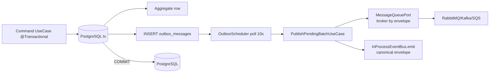

# Platform Services — Complete Flow

> Generated: 2026-10-11 · Source of truth: `src/platform/*/README.md` + `ARCHITECTURE.md` §9 + `docs/FLOWCHARTS.md` + `src/config/*` + `prisma/schema/platform/*`.
> Every class/port/file name below is the real one in `src/`. Business code may only touch these services through the listed **port tokens** via `imports: [PlatformModule]` — never concrete services, never `@infrastructure`, never `@business/**` from platform (ESLint-enforced).

## Table of Contents

1. [Composition root & global request pipeline](#0-composition-root--global-request-pipeline)
2. [Context (request identity + tenancy + read replica)](#1-context--request-identity--tenancy--read-replica)
3. [Outbox (transactional publish)](#2-outbox--transactional-publish)
4. [Events (in-process dispatch only)](#3-events--in-process-dispatch-only)
5. [Messaging + MessageQueue (broker adapters)](#4-messaging--messagequeue--broker-adapters)
6. [Inbox (consumer-side deduplication)](#5-inbox--consumer-side-deduplication)
7. [Locking (distributed lease)](#6-locking--distributed-lease)
8. [Idempotency (duplicate suppression + replay)](#7-idempotency--duplicate-suppression--replay)
9. [Scheduler (durable TIME wake-ups)](#8-scheduler--durable-time-wake-ups)
10. [Recurring (document-generation series)](#9-recurring--document-generation-series)
11. [Batch-operation (bulk transitions)](#10-batch-operation--bulk-transitions)
12. [Import (spreadsheet/CSV pipeline)](#11-import--spreadsheetcsv-pipeline)
13. [Condition-engine (AND/OR generation gate)](#12-condition-engine--andor-generation-gate)
14. [Saga (company-configurable orchestration)](#13-saga--company-configurable-orchestration)
15. [Webhook (inbound receipt + outbound dispatch)](#14-webhook--inbound-receipt--outbound-dispatch)
16. [Notification (email/SMS/push pipeline)](#15-notification--emailsmspush-pipeline)
17. [Numbering (document sequences)](#16-numbering--document-sequences)
18. [Audit (actor/tenant trail)](#17-audit--actortenant-trail)
19. [Configuration (company settings)](#18-configuration--company-settings)
20. [Storage (S3 objects)](#19-storage--s3-objects)
21. [Cache (disposable K/V)](#20-cache--disposable-kv)
22. [Observability (logs/metrics/errors)](#21-observability--logsmetricserrors)
23. [End-to-end golden paths](#22-end-to-end-golden-paths)

---

## 0. Composition root & global request pipeline

**Files:** `src/platform/platform.module.ts`, `src/app.module.ts`, `src/bootstrap/*`, `src/shared-kernel/*`.

```text
Client → Fastify → RequestIdInterceptor (seeds CLS RequestContext)
       → TenancyAuthGuard (APP_GUARD, single vs multi)
       → Response/Logging/DeviceResponse interceptors + AppValidationPipe (Zod)
       → Controller → UseCase (@Transactional) → ports only
```

- `PlatformModule` imports + re-exports all 20 service modules. Deliberately **not `@Global()`**.
- Raw clients (`Prisma, amqplib, kafkajs, ioredis, S3, SES/SNS`) live in `src/infrastructure/*` only.
- Platform owns its event contract — `OutboxEvent / OutboxEventBase / OutboxEnvelope` (`platform/outbox/outbox.types.ts`). Business `DomainEvent` satisfies `OutboxEvent` **structurally** (same envelope fields), so the outbox pipes it verbatim: the payload is persisted and delivered as-is, with **no rehydration step** and no business registry delegate. Platform never imports `@business/**`.
- Business opt-in registries (`BatchOperationHandler`, `ImportHandler`, `NotificationHandler`, `ScheduledJobFireHandler`, `FieldResolver`, webhook sources) are filled by **composition root** `src/bootstrap/configure-*.ts`, never by platform importing business. Exception: recurring→scheduler is platform→platform and registers in `RecurringModule.onApplicationBootstrap`.

---

## 1. Context — request identity + tenancy + read replica

> Removes per-request param threading; the tenancy trust boundary.

**Module:** `src/platform/context/context.module.ts` → `ContextModule` (exports `RequestContextPort`, `PrismaReadPort`).
**Ports:**

```ts
// ports/request-context.port.ts
abstract class RequestContextPort {
  isAvailable(): boolean;
  get(): RequestContext | null;
  require(): RequestContext;
  set(patch: Partial<RequestContextData>): void;
  run<T>(patch: Partial<RequestContextData>, fn: () => T | Promise<T>): Promise<T>;
  getRequestId(): string | undefined;
  getCorrelationId(): string | undefined;
  getTenantId(): string | undefined;
  getOrganizationId(): string | undefined;
  getUserId(): string | undefined;
}
// impl: adapters/cls-request-context.service.ts (over nestjs-cls, key CLS_REQUEST_CONTEXT_KEY)
// ports/request-context.ts: RequestContextData{requestId,correlationId,tenantId?,organizationId?,userId?,roles[],locale,ip?,userAgent?}
// ports/prisma-read.port.ts: abstract class PrismaReadPort extends PrismaClient
// impl binding: useExisting PrismaReadService (infrastructure/database/prisma)
// guards/tenancy-auth.guard.ts: TenancyAuthGuard (APP_GUARD in app.module), @SkipTenancy() opt-out
```

**Complete flow:**

1. HTTP: `RequestIdInterceptor` creates one CLS context per request (`requestId`, `x-correlation-id`).
2. `TenancyAuthGuard`: `TENANCY_MODE=single` → trust `x-tenant-id` headers (pass-through). `multi` → require `Authorization: Bearer <jwt>` signed with `JWT_ACCESS_SECRET`, extract `tenantId` claim → stash `VerifiedIdentity` on request; interceptor ignores raw headers. Missing/invalid → 401; missing `tenantId` claim → 403.
3. Any layer: `requestContextPort.get()/require()/getTenantId()` — no param threading.
4. Background (BullMQ workers, outbox re-dispatch, scheduler/recurring/batch/import): `requestContextPort.run({tenantId, organizationId, correlationId}, fn)` — the **only** sanctioned child-context mechanism. `require()` throws if forgotten.
5. Queries: business `*QueryRepository` injects `PrismaReadPort` (replica pool; falls back to write pool when no replica URL).

**Who calls / how:**

| Caller                                                                                      | Surface                                            |
| ------------------------------------------------------------------------------------------- | -------------------------------------------------- |
| All HTTP controllers/interceptors                                                           | `RequestContextPort.get/require`                   |
| All command/query repos (`PrismaReadPort`), outbox writer, audit, numbering, company-config | `RequestContextPort` for tenant/org/actor stamping |
| Every BullMQ worker + `OutboxDispatcherAdapter` re-dispatch                                 | `RequestContextPort.run(patch, fn)`                |

**Data & config:** No tables. `src/config/security.config.ts` (`TENANCY_MODE`, header names), `src/config/auth.config.ts` (`JWT_ACCESS_SECRET/REFRESH_SECRET`, fail-fast in prod).
**Tenancy:** This _is_ the foundation. Single = fail-open deliberate; multi = JWT-verified fail-closed.
**Rules:** Never `set()` on request path; `run()` only for background; never `@Global()`; multi deployments must run `TENANCY_MODE=multi`.

---

## 2. Outbox — transactional publish

> The only sanctioned way for a state change to leave the process. `src/platform/outbox/README.md`.

**Module:** `src/platform/outbox/outbox.module.ts` → `OutboxModule`.
**Ports:**

```ts
// ports/outbox-writer.port.ts — the ONLY outbox port
abstract class OutboxWriterPort {
  append(
    event: OutboxEvent,
    aggregateType: string,
    aggregateId: string,
    opts?: { broker?: BrokerTarget },
  ): Promise<void>;
}
// impl: OutboxService → AppendOutboxEventUseCase
// repositories/prisma-outbox.repository.ts (concrete, no port): append(request),
// claimBatch({batchSize,maxAttempts,claimLeaseMs}), markPublished(id,claimToken),
// markFailed(id,claimToken,error,nextRetryAt,maxAttempts), deletePublishedOlderThan(hours)
// usecases/publish-pending-batch.usecase.ts — claim → publish → emit → CAS settle
```

Types (`outbox.types.ts`): `BrokerTarget='rabbitmq'|'kafka'|'sqs'`; `OutboxEnvelope` (the single canonical transport envelope); `OutboxEvent`/`OutboxEventBase` (platform event contract); `OutboxStatus=PENDING|PUBLISHED|DEAD_LETTER`; `AppendOutboxEventRequest{tenantId?,organizationId?,eventId,eventType,eventVersion?,aggregateType,aggregateId,payload,occurredAt?,correlationId?,causationId?,headers?,broker?,nextRetryAt?}`.

**Complete flow:**



1. **Append (in business tx):** use case → `<Aggregate>IntegrationPort` → `OutboxAdapter` → `OutboxWriterPort.append(event, aggregateType, aggregateId, opts?)` → `AppendOutboxEventUseCase` → concrete `PrismaOutboxRepository.append` on the caller's `TransactionHost`. `tenantId/organizationId/eventId/correlationId/causationId` stamped from CLS; `opts.broker` (default `rabbitmq`) written into `headers.broker`. COMMIT is atomic (data + event). Nothing is published here.
2. **Poll:** `outbox.scheduler.ts` `setInterval(pollIntervalMs)` → `PublishPendingBatchUseCase.execute()` (overlap-guarded); cron `EVERY_HOUR` deletes `PUBLISHED` rows past retention.
3. **Claim:** `claimBatch({batchSize,maxAttempts,claimLeaseMs})` runs a single `UPDATE … WHERE id IN (SELECT … FOR UPDATE SKIP LOCKED)` over due `PENDING` rows (`nextRetryAt<=now` and claim missing or older than the lease), stamps `claimToken+claimedAt`, bumps `attempts` — **status stays `PENDING`** (the lease is the in-flight marker). Concurrent replicas claim disjoint rows; order is `createdAt` asc.
4. **Dispatch per record:** build the canonical `OutboxEnvelope` (broker read from `headers.broker`, default `rabbitmq`) → `MessageQueuePort.publish(envelope)` → then `RequestContextPort.run({tenantId,…})` → `InProcessEventBus.emit(envelope)`. In-process throw = log-only (the broker already holds it).
5. **Settle:** success → `markPublished(id,claimToken)` (CAS). Publish throw → `nextRetryAt=now+baseMs*2^(attempts-1)` → `markFailed(id,claimToken,error,nextRetryAt,max)` → stays `PENDING`, or `DEAD_LETTER` when `attempts>max` (terminal, alertable).
6. **No reconciler:** a crashed owner's lease simply expires and the next tick reclaims the row through the same claim clause.

**Who calls / how:**

| Caller                                              | Surface                                                |
| --------------------------------------------------- | ------------------------------------------------------ |
| Every command use case (via module `OutboxAdapter`) | `OutboxWriterPort.append` (same tx)                    |
| `OutboxScheduler` (internal cron + tick)            | `PublishPendingBatchUseCase`, `PrismaOutboxRepository` |
| Nobody publishes brokers directly                   | `MessageQueuePort` only via the dispatcher             |

**Data & config:** `outbox_messages` (`prisma/schema/platform/outbox.prisma`, indexes `[status,nextRetryAt]`, `[tenantId,organizationId,status]`). `src/config/outbox.config.ts` (`ConfigService.getOutbox()`): `OUTBOX_POLL_INTERVAL_MS=10000`, `OUTBOX_BATCH_SIZE=100`, `OUTBOX_MAX_ATTEMPTS=10`, `OUTBOX_RETRY_BASE_DELAY_MS=1000`, `OUTBOX_RETRY_MAX_DELAY_MS=600000`, `OUTBOX_CLAIM_LEASE_MS=60000`, `OUTBOX_CLEANUP_OLDER_THAN_HOURS=24`.
**Tenancy:** stamped at append, restored on in-process CLS + carried in broker headers; the dispatcher claims globally (stateless).
**Rules:** Never publish inside business tx; every settle is CAS on `claimToken`; stable `eventId` for consumer dedupe; in-process delivery is best-effort and never reflected onto the row.

---

## 3. Events — in-process dispatch only

> A thin emit wrapper over `EventEmitter2`: same envelope the brokers carry, zero
> durability. `src/platform/events/README.md`.

**Module:** `src/platform/events/events.module.ts` → `EventsModule`.
**Ports:**

```ts
// ports/in-process-event-bus.port.ts — the only port
type MessageEnvelope = OutboxEnvelope; // canonical envelope alias
abstract class InProcessEventBus {
  emit(envelope: MessageEnvelope): void; // at-most-once, no retries, no storage
}
// impl: EventBusService → EmitEventUseCase → NestEventBusAdapter (EventEmitter2)
```

Envelope: the canonical `OutboxEnvelope` from `platform/outbox/outbox.types.ts`
(`eventId`, `eventType`, `aggregateType`, `aggregateId`, `payload`, `headers`,
`occurredAt`, `broker?`, `correlationId?`, `causationId?`). No rehydration types.

**Complete flow:**

1. The only caller is the outbox dispatcher (`PublishPendingBatchUseCase`) — business never emits directly.
2. `EventBusService.emit(envelope)` → `EmitEventUseCase` → `NestEventBusAdapter.emit(envelope)` → `emitter.emit(envelope.eventType, envelope)`.
3. Subscribers: business `*.event-emitter.listener-event.ts` (`@OnEvent('<EventType>')`, receives `MessageEnvelope`, reads `message.payload`) plus platform `onAny` projections (recurring / notification / webhook), which match on the event type.

**Who calls / how:** `platform/outbox` emits after the broker publish, under a restored tenant CLS context; business listeners react locally. Reactions that must survive a crash belong behind a broker consumer + `platform/inbox`.
**Data & config:** None (no tables, no config, no cron).
**Rules:** Keep in-process handlers idempotent and non-throwing — the adapter catches and logs, so one bad listener never breaks the others or the outbox row.

---

## 4. Messaging / MessageQueue — one port, broker by param

> Infrastructure-agnostic async transport; the envelope picks the broker. `src/platform/messaging/README.md`.

**Module:** `messaging.module.ts` → `MessagingModule` (imports `@infrastructure/messaging`).
**Ports:**

```ts
// ports/message-queue.port.ts — the only public port
abstract class MessageQueuePort {
  publish(envelope: OutboxEnvelope): Promise<void>; // routes on envelope.broker (default rabbitmq)
}
// impl: MessageQueueService → PublishMessageUseCase → BrokerPublisher adapters
// message-publisher.tokens.ts: interface BrokerPublisher + abstract RabbitMqPublisher/KafkaPublisher/SqsPublisher
```

**Complete flow:**

1. `PublishPendingBatchUseCase` (outbox) injects `MessageQueuePort`; the scheduler fallback (`RabbitMqSchedulerEventPublisher` → `SchedulerEventPublisherPort`) does too. Business never publishes.
2. `PublishMessageUseCase.execute(envelope)` switches on `envelope.broker ?? 'rabbitmq'` across the three adapters. Per-broker shape: RabbitMQ routing-key=`eventType` on `rabbitmq.exchange`, persistent; Kafka topic=`eventType`, key=`aggregateId`; SQS to the configured queue URL. Every transport carries the same canonical envelope.
3. An unconfigured broker target throws — `publish` rejects, the outbox keeps the row `PENDING` and retries it to `DEAD_LETTER`; a missing broker never blocks a transaction.

**Data & config:** No tables. `src/config/messaging.config.ts` (`RABBITMQ_URL`, `RABBITMQ_EXCHANGE`, `KAFKA_BROKERS`, `SQS_URL`, `SQS_REGION`).
**Rules:** Business never imports broker libs (ESLint). New broker = implement `BrokerPublisher` + register a token + extend `BrokerTarget` and the publish switch — never hand-roll producers in business modules. At-least-once; consumers dedupe on the stable `event-id` via inbox/idempotency. No consumers, no subscribe registry.

---

## 5. Inbox — consumer-side deduplication

> The consumer counterpart of Outbox: the same logical message + the same
> consumer yields exactly one business execution under at-least-once delivery.
> `src/platform/inbox/README.md`.

**Module:** `src/platform/inbox/inbox.module.ts` → `InboxModule` (imports `Context,Prisma`; exports `InboxPort`).
**Ports:**

```ts
// ports/inbox.port.ts — the only port
abstract class InboxPort {
  receive(req: InboxReceiveRequest): Promise<InboxReceiveResult>;
  complete(req: InboxCompleteRequest): Promise<void>;
  fail(req: InboxFailRequest): Promise<void>;
}
// InboxReceiveRequest={tenantId?,organizationId?,consumer,messageId,messageType,payload,correlationId?,causationId?}
// InboxReceiveResult= ACQUIRED{reservation:{id,claimToken}} | DUPLICATE | BUSY
// impl: InboxService → Receive/Complete/FailUseCase → PrismaInboxRepository (concrete)
```

**Complete flow:**

1. Listener calls `receive()`: INSERT-as-claim on `(tenant, company, consumer, messageId)` → success ⇒ `ACQUIRED` (first delivery wins; the reservation carries `id` + `claimToken`).
2. On unique violation → read the row: `PROCESSED` ⇒ `DUPLICATE` (skip); `SUSPENDED` ⇒ `BUSY`; `IN_PROGRESS` while the claim is live (inside `INBOX_CLAIM_LEASE_MS`) or the retry is not due ⇒ `BUSY`; otherwise CAS re-claim on the stored token (`attempts + 1`) ⇒ `ACQUIRED` (losing the race ⇒ `BUSY`).
3. `RequestContextPort.run` restores tenant/company/correlation; the listener executes the payload, then `complete` (CAS `claimToken` → `PROCESSED`) fires the broker ACK.
4. Failure → `fail` keeps the row `IN_PROGRESS` with an exponential `nextAttemptAt` + `lastError`; the broker NACK drives redelivery.
5. `InboxReconciler` (@Cron 60s): an expired claim with `attempts > INBOX_MAX_ATTEMPTS` parks `SUSPENDED` (alertable, never purged); the rest get a fresh backoff; the same sweep deletes `PROCESSED` rows past `INBOX_PROCESSED_RETENTION_MS`.

**Data & config:** `inbox_messages` (`prisma/schema/platform/inbox.prisma`; `@@unique([tenantId,organizationId,consumer,messageId])` with NULLs normalized to `''` at the repo edge; `IN_PROGRESS|PROCESSED|SUSPENDED`; CAS on `claimToken`). `src/config/inbox.config.ts`: `INBOX_CLAIM_LEASE_MS=300000`, `INBOX_MAX_ATTEMPTS=5`, `INBOX_RETRY_BASE_DELAY_MS=5000`, `INBOX_RETRY_MAX_DELAY_MS=600000`, `INBOX_RECONCILIATION_INTERVAL_MS=60000`, `INBOX_PROCESSED_RETENTION_MS=2592000000`.
**Tenancy:** the natural key is tenant + company + consumer + message id; different consumers process the same `messageId` independently.
**Rules:** Business consumes only `InboxPort`; ACK only after `complete`; every write CAS; poison is parked, never dropped; events a consumer produces leave via the outbox in the same transaction.

---

## 6. Locking — distributed lease

> "One replica now" (exactly-once-in-time). `src/platform/locking/README.md`.

**Module:** `src/platform/locking/locking.module.ts` → `LockingModule`.
**Ports:**

```ts
// ports/distributed-lock.port.ts — ONLY port business injects
abstract class DistributedLockPort {
  acquire(req: DistributedLockAcquireRequest): Promise<DistributedLockAcquireResult>;
  renew(req: DistributedLockRenewRequest): Promise<DistributedLockRenewResult>;
  release(req: DistributedLockReleaseRequest): Promise<void>;
}
// impl: DistributedLockService → Acquire/Renew/ReleaseDistributedLockUseCase
// internal ports/redis-lock.port.ts → RedisDistributedLockAdapter (SET NX PX, Lua renew/release)
// internal ports/distributed-lock-repository.port.ts → PrismaDistributedLockRepository (getOrCreate, nextFencingToken)
```

Types (`locking.types.ts`): identity `{tenantId,organizationId,scope,resource}`, `AcquireResult={ACQUIRED,ticket}|{BUSY,retryAfterMs}`, ticket `{lockId,lockKey,ownerToken,fencingToken,acquiredAt,expiresAt}`. Key: `LockKeyBuilder` → `{tenantId}:{organizationId}:{scope}:{resource}`, adapter prepends `lock:`.

**Complete flow:**

1. `acquire({scope,resource,leaseMs?})` → build key → `randomUUID()` ownerToken → `RedisLockPort.acquire` (SET NX PX, fail-fast; BUSY → return `BUSY`, no DB touch) → on success `repository.nextFencingToken(identity)` (atomic PG upsert-increment) → `getOrCreate` for `lockId` → `ACQUIRED{ticket}`.
2. Long-running: periodic `renew({ticket,leaseMs})` → Lua ownership+PEXPIRE → `RENEWED` or `LOST` (stop processing).
3. `release({ticket})` in `finally` → Lua ownership+DEL, idempotent best-effort (TTL is the backstop).

**Who calls / how:** scheduler ticker per `jobId`, import stage locks (`StageLock`), any "one-winner" worker — all via `DistributedLockPort`. Fail-closed: BUSY ⇒ skip work, never speculative.
**Data & config:** `distributed_locks` (`prisma/schema/platform/locking.prisma`, `@@unique[tenantId,organizationId,scope,resource]`, `fencingToken BigInt`). `src/config/locking.config.ts`: `LOCK_DEFAULT_LEASE_MS=30000`, `MIN=5000`, `MAX=300000`, `RENEW_INTERVAL=10000`. Redis via `InfraCacheModule`.
**Rules:** Redis down on acquire → `BUSY` (logged); PG down → throw (no fencing token = unsafe); never inject `RedisService` directly, never hand-build keys, never use as cache/idempotency; always release in `finally`; downstream rejects stale owners via fencing token.

---

## 7. Idempotency — duplicate suppression + replay

> "Effect exactly once over time" (vs locking's lease). `src/platform/idempotency/README.md`.

**Module:** `src/platform/idempotency/idempotency.module.ts` → `IdempotencyModule` (installs `IdempotencyInterceptor` as global `APP_INTERCEPTOR`, inert unless decorated).
**Ports:**

```ts
// ports/idempotency.port.ts
abstract class IdempotencyPort {
  reserve(req: IdempotencyReserveRequest): Promise<IdempotencyReserveResult>;
  complete(req: IdempotencyCompleteRequest): Promise<void>;
  fail(req: IdempotencyFailRequest): Promise<void>;
}
// impl: IdempotencyService → Reserve/Complete/FailIdempotencyUseCase
// IdempotencyIdentity={tenantId,organizationId,scope,key}
// ReserveResult= {ACQUIRED,reservation:{id,claimToken,version}} | {REPLAY,result} | {IN_PROGRESS} | {SUSPENDED} | {KEY_REUSED}
// http/idempotent.decorator.ts: @Idempotent() + IDEMPOTENCY_HEADER='idempotency-key'
```

**Complete flow (programmatic):**

1. `reserve({scope,key,tenantId,organizationId,requestHash?,ttlMs?})` → `INSERT IN_PROGRESS` (insert-as-claim on `@@unique[tenantId,organizationId,scope,key]`) → `ACQUIRED` → execute → `complete({reservation,result})` (CAS `version+token` → `COMPLETED+resultJson`) or `fail` (→ `FAILED`, re-arms immediately).
2. Retried `COMPLETED` → `REPLAY+result`; concurrent `IN_PROGRESS` → `IN_PROGRESS`; `requestHash` mismatch → `KEY_REUSED`; `FAILED/SUSPENDED/expired` → atomic `takeover` → `ACQUIRED`.

**Complete flow (HTTP):** `IdempotencyInterceptor`: metadata check → require non-blank `Idempotency-Key` (else 400) → `reserve({scope: Controller.method, key, tenant/org from RequestContextPort})` → `REPLAY`→return stored result (handler never runs); `IN_PROGRESS/SUSPENDED/KEY_REUSED`→409; `ACQUIRED`→`next.handle().pipe(complete on success, fail+rethrow on error)`.

**Reconciler** (`idempotency-reconciliation.ts`, hourly): `suspendExpiredClaims(claimLeaseMs)` (`IN_PROGRESS`+old `claimedAt`→`SUSPENDED`); `purgeExpired()` (past `expiresAt` → delete).
**Who calls / how:** `POST /batch-operations`, `POST /import/jobs` (`@Idempotent()`), inbound webhooks (`IdempotencyPort.reserve` with `scope='webhook.inbound.{source}'`).
**Data & config:** `idempotency_keys` (`prisma/schema/platform/idempotency.prisma`, `tenantId` normalized to `''` when unscoped). `src/config/idempotency.config.ts`: `IDEMPOTENCY_TTL_MS=86400000`, `CLAIM_LEASE_MS=300000`, `RECONCILIATION_INTERVAL=3600000`.
**Rules:** Only on non-idempotent verbs (never GET); stored `resultJson` is one modest JSON value (ledger, not cache); replays are byte-identical pipeline output; CAS `claimToken+version` on all writes.

---

## 8. Scheduler — durable TIME wake-ups

> DB is the source of truth for _when_; callers own _what_. `src/platform/scheduler/README.md`.

**Module:** `src/platform/scheduler/scheduler.module.ts` → `SchedulerModule` (imports `Context,Audit,Locking,Messaging,Bull[scheduler.jobs]`; controllers `SchedulerController,SchedulerHealthController`; exports `SchedulerPort,ScheduledJobHandlerRegistry`).
**Ports:**

```ts
// ports/scheduler.port.ts — ONLY surface business code uses
abstract class SchedulerPort {
  schedule(input: ScheduleJobInput): Promise<string>; // {jobType,aggregateType,aggregateId,nextRunAt,tenantId?}
  reschedule(jobId: string, nextRunAt: Date): Promise<void>;
  cancel(jobId: string): Promise<void>;
  cancelByAggregate(aggType: string, aggId: string): Promise<void>;
  rescheduleByAggregate(aggType: string, aggId: string, nextRunAt: Date): Promise<void>;
}
// impl: adapters/scheduler.adapter.ts → RegisterScheduledJobUseCase / CancelScheduledJobUseCase / RescheduleExternalJobUseCase
// ports/scheduled-job-repository.port.ts → PrismaScheduledJobRepository (create/findById/list/count/cancel*/reschedule*/claimDue(batchSize,lockedBy)/markPendingWithNextRun/touchLastRunAt/markRunningExternal/recordFailure/releaseStaleClaims/updateWithVersionCheck)
// ports/scheduled-job-fire-handler.port.ts: interface ScheduledJobFireHandler { handle(payload: ScheduledJobPayload): Promise<void> }
// payload={jobId:string|null,tenantId?,jobType,scope?,aggregateType?,aggregateId?,payload?,attempt?,sourceEventId?,eventPayload?,idempotencyKey?}
// ports/scheduler-job-queue.port.ts → BullMqSchedulerQueueAdapter.enqueue
// ports/scheduler-event-publisher.port.ts → RabbitMqSchedulerEventPublisher (topic scheduler.job.<jobType>)
// ScheduledJobHandlerRegistry: register(jobType,handler)/resolveHandler/has — keyed by jobType
```

**Complete flow:**

1. **Register:** `SchedulerPort.schedule()` → `RegisterScheduledJobUseCase` → `scheduled_jobs` PENDING row. HTTP `POST /api/v1/scheduled-jobs`.
2. **Poll:** `scheduler.ticker.ts` `SchedulerTicker` (interval `SCHEDULER_POLL_INTERVAL_MS=30s`) → `DispatchDueJobsUseCase`: `claimDue FOR UPDATE SKIP LOCKED` → CLAIMED.
3. **Lease:** `DistributedLockPort.acquire({scope:'scheduled-job',resource:jobId})` — fail-closed: BUSY ⇒ leave CLAIMED for reconcile.
4. **Enqueue:** `queue.enqueue({…,idempotencyKey})` BullMQ `scheduler.jobs`, `jobId=idempotencyKey=sha256(jobId:slot)`. Dispatch-log upsert on same key. No outbox row.
5. **Next:** CRON → `CronCalculator.nextRunAt(cron)` → `markPendingWithNextRun`; EXTERNAL → `touchLastRunAt`, stays CLAIMED until owner `reschedule` (recurring uses EXTERNAL).
6. **Execute:** `adapters/bullmq-scheduler-job.worker.ts` → `ScheduledJobProcessor.process()`: authoritative CANCELLED/SUSPENDED check (drop) → registry has `jobType`? `handler.handle(payload)` in-process : `publisher.publishJobDue` (external subscriber).
7. **Failure:** `recordFailure` exponential backoff `nextRunAt`, `retryCount++`; after `maxRetries` → SUSPENDED + dispatch-log `DEAD_LETTERED`.
8. **Reconcile:** `ReconcileMissedJobsUseCase` (interval): releases stale CLAIMED/RUNNING; CRON `skip-to-next`, EXTERNAL `catch-up`.
9. **Ops:** `/scheduled-jobs` (list/get/dispatch-log/patch+version/cancel/dispatch-now), `/scheduler/health`.

**Data & config:** `scheduled_jobs` + `scheduled_job_dispatch_log` (id=idempotencyKey unique, `SUCCESS/FAILED/DEAD_LETTERED`) + `scheduled_job_edit_log` (`prisma/schema/platform/scheduler.prisma`). `src/config/scheduler.config.ts`: `POLL=30000`, `BATCH=20`, `LOCK_TTL=300000`, `RECONCILIATION=300000`, `WORKER_CONCURRENCY=5`, `JOB_ATTEMPTS=3`, `MAX_RETRIES=5`, `BACKOFF_BASE=60000`.
**Tenancy:** stamped at register, restored into CLS by worker; `multi` handlers treat `payload.tenantId` as authenticated.
**Rules:** One use case/file; `SchedulerPort` is the sole surface; cancel/suspend authoritative; terminal writes guarded; per-slot `sha256(jobId:slot)` dedupes crash-re-fire; registration in `onApplicationBootstrap`.

---

## 9. Recurring — document-generation series

> Owns template + execution history; scheduler owns wake-ups; never creates documents itself. `src/platform/recurring/README.md`.

**Module:** `src/platform/recurring/recurring.module.ts` → `RecurringModule implements OnApplicationBootstrap` (imports `Context,Audit,Outbox,Scheduler,ConditionEngine`; exports `RecurringExecutionPort,RecurringTemplatePort`; `onApplicationBootstrap: scheduledJobHandlers.register('Recurring', generationHandler)` — platform→platform).
**Ports:**

```ts
// ports/recurring-template.port.ts → RecurringTemplateAdapter
abstract class RecurringTemplatePort {
  create(input: CreateRecurringTemplateInput): Promise<RecurringTemplateRecord>;
}
// ports/recurring-execution.port.ts → RecurringExecutionAdapter
abstract class RecurringExecutionPort {
  findById(id: string): Promise<RecurringExecutionRecord | null>;
  complete(id: string, input: CompleteExecutionInput): Promise<void>;
  fail(id: string, errorMessage: string): Promise<void>;
}
// internal: RecurringTemplateRepositoryPort / RecurringExecutionRepositoryPort (create/findById/update/claim({templateId,triggerKey,…})/skip/fail/complete)
// recurring-generation.handler.ts: RecurringGenerationHandler implements ScheduledJobFireHandler
```

**Complete flow — TIME:**

1. `POST /recurring-templates` → `CreateRecurringTemplateUseCase @Transactional`: validate `partyType` map (`PurchaseOrder/Bill→VENDOR`, `Invoice→CUSTOMER`), require frequency/interval/startDate + non-empty lines → `recurring_templates` row + `SchedulerPort.schedule({jobType:'Recurring',aggregateType:'RecurringTemplate',aggregateId:template.id,nextRunAt})` in **one tx**.
2. `SchedulerTicker` claims → `ScheduledJobProcessor` → registry `Recurring` handler in-process (`jobId!=null`).
3. Handler `@Transactional`: `findById(aggregateId)` → tenant-mismatch throw → `triggerKey=YYYY-MM-DD(nextRunDate)` → `executionRepository.claim` insert-as-claim on `(templateId,triggerKey)`; collision ⇒ skip (sweeper heals).
4. Template not ACTIVE → `skip(TemplateNotActive)`. Else parse `generationCondition` → `ConditionEvaluator.evaluate`; fail → `skip(ConditionNotMet)` + reschedule.
5. Pass → `OutboxWriterPort.append(new RecurringOccurrenceRequested(executionId,templateId,targetEntityType,partyId,partyType,currency,autoPost,triggerKey,traceId,headerOverrides,lines,tenantId,eventPayload), 'RecurringTemplate', template.id)`.
6. `reschedule`: `RecurrenceEngine.nextRunDate(frequency,interval,from,timeZone)` → `template.update(nextRunDate,lastRunDate)` + `schedulerPort.rescheduleByAggregate`; past `endDate` → COMPLETED + `cancelByAggregate`.
7. Outbox dispatcher → Rabbit `erp.events/RecurringOccurrenceRequested` → business creates doc → `RecurringExecutionPort.complete/fail`.

**Complete flow — EVENT:** no `scheduled_jobs` row. `domain-event.dispatcher.ts` (`EventEmitter2.onAny`) matches ACTIVE templates by `eventName`, calls same handler with `jobId:null`, `triggerKey=sourceEventId`.

**Business consumer trio (copy per aggregate):** listener (`recurring-occurrence.<agg>.erp`) → `GenerateRecurring<Agg>UseCase` (guard `targetEntityType` + execution `IN_PROGRESS`? → `Create<Agg>UseCase` in own tx with `NumberingPort` → `RecurringExecutionPort.complete(snapshot)` → optional auto-submit/post) + two template-entry use cases via `RecurringTemplatePort` (manual + `POST /purchase-orders/:id/recurring` snapshotting existing doc). PurchaseOrder + Invoice ship this today.

**Data & config:** `recurring_templates` (`@@unique([tenantId,templateNo])`, `ACTIVE/PAUSED/CANCELLED/COMPLETED`, `TIME/EVENT`, `DAILY/WEEKLY/MONTHLY/YEARLY`) + `recurring_executions` (`@@unique([recurringTemplateId,triggerKey)]` = idempotency, `IN_PROGRESS/SUCCESS/FAILED/SKIPPED`, FK to `ScheduledJob` SetNull) (`prisma/schema/platform/recurring.prisma`). No dedicated config (uses scheduler+outbox+numbering+audit). `SweepStaleExecutionsUseCase` hourly fails stale `IN_PROGRESS` (never auto-regenerates).
**Tenancy:** template owns tenancy; handler rejects payload-tenant mismatch.
**Rules:** Whole handler one tx (claim+outbox+reschedule commit/rollback together); terminal writes only while `IN_PROGRESS`; pause/resume/cancel write `AuditPort`.

---

## 10. Batch-operation — bulk transitions

> One operation × many records as a tracked unit. `src/platform/batch-operation/README.md`.

**Module:** `src/platform/batch-operation/batch-operation.module.ts` → `BatchOperationModule` (imports `Context,Audit,Numbering,Outbox,Bull[batch-operations]`; exports use cases + `BatchOperationHandlerRegistry`; **no inbound ports** — controller/worker inject use cases directly).
**Ports:**

```ts
// ports/batch-operation-handler.port.ts (plugin contract, impl per aggregate)
interface BatchOperationHandler {
  aggregateType(): string;
  supportedOperations(): string[];
  validate(entityId, operationCode, params, ctx: BatchOperationContext): Promise<ValidationResult>; // pure, never mutates
  execute(entityId, operationCode, params, ctx): Promise<ExecutionResult>; // delegates to aggregate's own single-record use case
}
// ports/batch-operation-job-repository.port.ts + ports/batch-operation-job-row-repository.port.ts → PrismaBatchOperationJobRepository
// (createJobWithRows/findJobWithRows/markJobFailed/recount/finalise/isCancelRequested | claimRow(rowId) UPDATE WHERE PENDING / settleRow(id,jobId,claimToken,{outcome,skipReason,errorMessage,resultSnapshot}))
// ports/batch-operation-queue-publisher.port.ts → BullMqBatchOperationQueueAdapter.dispatchChunks
// ports/batch-operation-job-outbox-writer.port.ts → PrismaBatchOperationJobOutboxWriter.writeCompletedEvent → BatchOperationJobCompleted
// BatchOperationHandlerRegistry: resolveHandler(aggType)/assertOperationSupported/register(handler) (dup aggType throws at boot)
```

**Complete flow:**

1. `POST /batch-operations {aggregateType,operationCode,entityIds}` (`@Idempotent()`) → `CreateBatchOperationJobUseCase`: fill tenant/user/trace from CLS (multi requires tenant); resolve handler + op; dedupe/cap ids; reject empty/`>maxRecordsPerJob`; decide `SYNC (n<=syncThreshold)` else `ASYNC`; `NumberingPort.nextNumber('batch-operation-job',{prefix:'BATCH-'})`; `createJobWithRows` header+PENDING rows in one tx (SYNC starts RUNNING, ASYNC PENDING).
2. SYNC → `BatchOperationWorker.processChunk` in-process → HTTP 200 with per-row results. ASYNC → `queuePublisher.dispatchChunks` (fixed chunks) → 202; publish fail → `markJobFailed`.
3. Per row `ProcessBatchOperationRowUseCase`: `isCancelRequested`? → `claimRow` (WHERE PENDING, bump `claimToken`; null ⇒ `SKIPPED_CLAIM`) → re-check cancel (settle `SKIPPED/CANCELLED_BY_REQUEST`) → `handler.validate` → `!canProceed` ⇒ SKIPPED → `handler.execute` ⇒ SUCCESS (+capped `resultSnapshot`) / catch ⇒ FAILED. Counters updated.
4. Terminal `finaliseJob` → outbox `BatchOperationJobCompleted`. `BatchOperationReconciliationConsumer` @Cron(5m): fence+reset stuck PROCESSING, recount, finalise settled, re-enqueue PENDING orphans.
5. Dry-run `POST /batch-operations/validate` → per-record preview, nothing persisted. Ops: `GET /batch-operations[/:id[/rows]]`, `POST /:id/cancel`, `GET /_registry`.

**Onboarding:** pure adapter in domain module (`PurchaseOrderBatchOperationAdapter`, `GrnBatchOperationAdapter` — validate/execute → own use cases) + one row in `src/bootstrap/configure-batch-operations.ts` (`BATCH_OPERATION_AGGREGATES`); bridge calls `registry.register(app.select(ownerModule).get(handler))` after instantiation.
**Data & config:** `batch_operation_jobs` (`@@unique([tenantId,jobNo])`, `SYNC/ASYNC`, `PENDING/RUNNING/COMPLETED/COMPLETED_WITH_ERRORS/FAILED/CANCELLED`, counters, `cancelRequested`) + `batch_operation_job_rows` (`@@unique([jobId,entityId)]`, `PENDING/PROCESSING/SUCCESS/FAILED/SKIPPED`, `claimToken` fencing) (`prisma/schema/platform/batch-operation.prisma`). `src/config/batch-operation.config.ts`: `MAX_RECORDS_PER_JOB=5000`, `SYNC_THRESHOLD=20`, `CHUNK_SIZE=50`, `WORKER_CONCURRENCY=5`, `CHUNK_ATTEMPTS=3`, `RECONCILIATION_WINDOW=300000`, `RESULT_SNAPSHOT_MAX=65536`.
**Tenancy:** tenant-stamped; `TenantScope.assertVisible` (foreign→404); handlers tenant-check entity resolution.
**Rules:** Handler pure thin router (3rd method = leak); never a special `Bulk*()` path; claim `UPDATE WHERE PENDING` + token-fenced settle; cancel honored between claims.

---

## 11. Import — spreadsheet/CSV pipeline

> Generic hexagonal bulk import into any aggregate. `src/platform/import/README.md`.

**Module:** `src/platform/import/import.module.ts` → `ImportModule` (imports `Context,Audit,Numbering,Outbox,Storage,Bull[import.jobs]`; exports `ImportHandlerRegistry`; controller/worker inject use cases directly).
**Ports:**

```ts
// ports/import-handler.port.ts (plugin contract)
interface ImportHandler<TRow> {
  preloadReferences(rows, ctx: ImportContext): Promise<PreloadedReferences>; // one query/ref-type/chunk
  validateBatch(rows, refs, ctx): Promise<RowVerdict[]>; // per-row, never abort job
  executeBatch(rows, ctx): Promise<RowResult[]>; // claim→domain txn→outcomes
}
// ports/import-job-repository.port.ts + import-job-row-repository.port.ts + storage-object-repository.port.ts
// ports/import-queue-publisher.port.ts → BullMqImportQueueAdapter (enqueueParse/Validate/Execute)
// ports/import-job-outbox-writer.port.ts → writeCompletedEvent/writeFailedEvent/writeCancelledEvent
// ImportHandlerRegistry: resolveHandler(entityKey)/resolveDescriptor(entityKey)
```

**Complete flow:**

1. `POST /import/uploads` → `CreateImportUploadUseCase`: `FileStoragePort.createPresignedUpload` + `storage_objects` row (`IMPORT_SOURCE`). Browser PUTs straight to S3.
2. `POST /import/jobs` (`@Idempotent()`) → `CreateImportJobUseCase` [TX]: snapshot registered descriptor onto job; BullMQ parse stage.
3. **Parse:** `ParseImportJobUseCase` + `ImportFileParser` (xlsx/CSV, header detection, alias mapping, structural checks) → suggested `ColumnMapping` → preview (`GET /import/jobs/:id/preview`).
4. **Mapping:** `PATCH /import/jobs/:id/mapping` (user confirm/override).
5. **Validate:** `ValidateImportJobUseCase` chunks (`validationChunkSize`): generic structural + `handler.validateBatch` → per-row `VALID/INVALID/DUPLICATE`, never aborts.
6. **Execute:** `POST /import/jobs/:id/execute` → `RunImportExecutionUseCase`: `requestContext.run({tenantId,traceId})` → `StageLock.acquire(jobId,'execute')` (locking; reconciler resumes only under same lock) → guard terminal/buildSha/descriptor version → loop: `isCancelRequested`→CANCELLED+outbox; `claimForExecution(chunkSize)` (token-fenced); re-validate chunk (staleness guard, invalid→SKIPPED); `handler.executeBatch(toExecute)` → `applyExecutionResults` (missing→FAILED, chunk throw→whole chunk FAILED, keep moving); `recountCounters`; terminal `COMPLETED/COMPLETED_WITH_ERRORS/FAILED` + outbox; error report → StorageObject.
7. `ImportReconciliationConsumer`: resumes orphaned stages via lock takeover; purges expired storage. HTTP: `GET /import/_registry`, `GET /:entityKey/init`, `GET /jobs[/:id[/report]]`, `POST /:id/cancel`.

**Registered entities:** `vendor` (`VendorImportHandler`, one row per vendor code/name — legacy module-side registration, migrate on touch), `purchase-order` (`PurchaseOrderImportHandler`, rows grouped by `poReference` → one DRAFT PO in `purchase_orders.externalReference` unique; lines set not summed; one txn per PO per chunk; INVALID on unknown vendor/SKU, vendor/currency drift, dup sku, non-DRAFT target). Onboarding = pure handler + one row in `src/bootstrap/configure-imports.ts` (`IMPORT_ENTITIES`).
**Data & config:** `storage_objects` (`@@unique([storageKey])`, `IMPORT_SOURCE/IMPORT_ERROR_REPORT/EXPORT_RESULT/OTHER`, `PENDING/CLEAN/INFECTED/SKIPPED`) + `import_jobs` (`@@unique([tenantId,jobNo])`, `PENDING_UPLOAD→…→COMPLETED/…`, descriptorSnapshot/columnMapping/statusHistory JSON, heartbeat/lock, version) + `import_job_rows` (`@@unique([importJobId,rowNumber)]`, `VALID/INVALID/DUPLICATE` × `PENDING/PROCESSING/APPLIED/FAILED/SKIPPED`, `executionClaimToken`) (`prisma/schema/platform/import.prisma`). `src/config/import.config.ts`: `MAX_FILE=25MB`, `MAX_ROWS=50000`, `VALIDATION_CHUNK=500`, `EXECUTION_CHUNK=200`, `LOCK_TTL=60000`, `WORKER_CONCURRENCY=5`, `RECONCILIATION_WINDOW=300000`, `PRESIGNED_TTL=900`, `PREVIEW_ROWS=10`, `SOURCE_RETENTION=7d`, `ROW_RETENTION=90d`, `BUILD_SHA`.
**Tenancy:** job+rows+storage tenant-stamped; `TenantScope` on every read (foreign→404); upload keys embed tenant; job may only reference same-tenant object (bearer token).
**Rules:** StageLock per async stage + reconciler never double-runs live phase; token-fenced `applyExecutionResults`; descriptor snapshotted + version-guarded; one domain txn per row owned by domain.

---

## 12. Condition-engine — AND/OR generation gate

> Sandboxed evaluation of stored `GenerationCondition` trees (only consumer: recurring). `src/platform/condition-engine/README.md`.

**Module:** `src/platform/condition-engine/condition-engine.module.ts` → `ConditionEngineModule` (exports `ConditionEvaluator,FieldResolverRegistry`; no tables/config).
**Ports:**

```ts
// ports/condition-evaluator.port.ts
type ConditionOperator = 'eq' | 'neq' | 'gt' | 'gte' | 'lt' | 'lte' | 'in' | 'notIn';
interface ConditionClause {
  field: string;
  operator: ConditionOperator;
  value: ConditionValue | ConditionValue[];
}
interface GenerationCondition {
  logic: 'AND' | 'OR';
  clauses: ConditionClause[];
}
interface ConditionEvaluationResult {
  passed: boolean;
  evaluatedValues: Record<string, ConditionValue | undefined>;
}
abstract class ConditionEvaluator {
  evaluate(cond: GenerationCondition, ctx: EvaluationContext): Promise<ConditionEvaluationResult>;
}
// impl: ConditionEvaluationService
// ports/field-resolver.port.ts
type ConditionValue = string | number | boolean | null;
interface EvaluationContext {
  tenantId?: string;
  traceId: string;
}
interface FieldResolver {
  resolve(field: string, ctx: EvaluationContext): Promise<ConditionValue>;
}
// field-resolver.registry.ts: FieldResolverRegistry extends KeyedRegistryBase<FieldResolver> { register(prefix,resolver); resolve(field,ctx) } — keyed by dotted-field first segment
// generation-condition.parser.ts: GenerationConditionParser.parse(json|null) → GenerationCondition|null (BadRequest on bad logic/operator/value)
```

**Complete flow (called by `recurring-generation.handler.ts`):**

1. Parse stored JSON via `GenerationConditionParser.parse` (null → caller decides pass; engine never invents null semantics).
2. `evaluator.evaluate(cond,{tenantId,traceId})`: per clause → `registry.resolve(field)` (split `.`, `getEntry(prefix)`; missing → `No FieldResolver registered for field '<field>'`) → `evaluatedValues[field]=value` → `matches`: `eq/neq` strict `===/!==`; `gt/gte/lt/lte` via `compare` (number-number `Math.sign`, string-string lexicographic, else `NaN`→false); `in/notIn` array includes.
3. Combine `AND→every`, `OR→some` → `{passed,evaluatedValues}` for audit.

**Who calls / how:** recurring only. Resolvers registered BY the data-owning module via composition-root bridge (engine imports no module). Today zero production resolvers — non-trivial condition throws until owner registers every prefix.
**Rules:** Duplicate prefix `register()` throws at boot; unknown operator throws; non-orderable → false; resolvers pure.

---

## 13. Saga — company-configurable orchestration

> Long-running cross-aggregate processes on ERP-standard defaults that every
> company narrows with its own overlay; the saga calls business actions, never
> repositories. `src/platform/saga/README.md`.

**Module:** `src/platform/saga/saga.module.ts` → `SagaModule` (imports `Context,Prisma,Outbox`; NOT `@Global()`; exports `SagaInboundPort,SagaActionRegistry`).
**Ports:**

```ts
// ports/feature-gate.port.ts — owned outside the saga
abstract class FeatureGate {
  enabled(companyId): Promise<ReadonlySet<string>>;
}
// ports/company-settings.port.ts
abstract class CompanySettingsReader {
  get(companyId): Promise<Record<string, unknown>>;
}
// ports/saga-action.port.ts — one command on one aggregate
interface SagaAction {
  readonly name: string;
  do(ctx): Promise<Result>;
  undo(ctx): Promise<Result>;
}
const SAGA_ACTION = 'SAGA_ACTION';
// ports/saga-inbound.port.ts — how events reach the saga
abstract class SagaInboundPort {
  accept(envelope: OutboxEnvelope): Promise<void>;
}
// application/plan-builder.ts — default + overlay merge (narrows only)
// application/expression.ts — safe evaluator + `{{ }}` templates + ISO durations
// application/saga-engine.ts — advance / complete / compensate / cancel
// application/saga-router.ts — five checks, start + wait
// workers/step-worker.ts — claim + run + settle
// repositories/prisma-saga.repository.ts — the five tables (one class per table)
```

**Complete flow — start (router):**

1. `FeatureGate.enabled(company)` + `CompanySettingsReader.get(company)` (read once, snapshotted; a lookup error aborts the start, never blocks another saga).
2. `PlanBuilder.build({definition, overlay, features, settings})` — required/standard/optional policy, `requires` filtering, AND-combined `if`/`when`, overridden timeout/retry. Empty plan ⇒ nothing starts.
3. `correlationKey = renderTemplate(start.key, {event})`; `context = {settings, event, start: mapContext(start.context)}`.
4. `SagaEngine.createAndAdvance` — `tryInsertLive` on the partial unique key (duplicate ⇒ one live instance already exists) then `advance`.

**Complete flow — advance / execute:**

1. `advance` walks the frozen plan from `cursor`: `if` false ⇒ record `SKIPPED`; `WAIT` ⇒ consume the oldest buffered matching event (`match` + `when`) or park `WAITING` with `run_at = timeout`; `DO` ⇒ write a `PENDING` step and stop.
2. `SagaStepWorker` claims due `DO|UNDO` rows (`FOR UPDATE SKIP LOCKED`, lease, fairness cap), resolves the `SagaAction`, runs it inside the instance's CLS.
3. `ok` ⇒ `markDone` + advance; `retry` ⇒ `nextRetry` backoff (exponential, capped) until `maxAttempts`; `fail`/exhaustion ⇒ `markFailed` + compensation.
4. Compensation creates `UNDO` rows for the completed `DO` steps in reverse (input = the DO output). A completed step with no undo, or a failure past the `pivot`, parks `FAILED_MANUAL`.
5. `SagaScheduler` tick: worker → expire `WAIT` timeouts (`skip` default / `compensate`) → re-queue stale leases. Hourly: purge inbox past retention. **No reconciler.**

**Data & config:** `saga_definitions` (one ACTIVE per key; found by `(event_name,event_version)`), `saga_company_configs` (one ACTIVE overlay per company+key), `saga_instances` (one live instance per tenant+company+key+correlation), `saga_steps` (unique `(instance,step,kind)`; `id` = action idempotency key), `saga_inbox` (dedupe on tenant+company+consumer+event). Partial uniques live in the migration. `src/config/saga.config.ts`: `SAGA_WORKER_LEASE_SECONDS=60`, `SAGA_CLAIM_BATCH_SIZE=20`, `SAGA_FAIRNESS_CAP=5`, `SAGA_SWEEP_INTERVAL_MS=10000`, `SAGA_RETRY_BASE_DELAY_MS=1000`, `SAGA_RETRY_MAX_DELAY_MS=600000`, `SAGA_DEFAULT_MAX_ATTEMPTS=5`, `SAGA_INBOX_RETENTION_DAYS=30`.
**Tenancy:** every row `(tenantId,organizationId)`; the router and the worker both run in `RequestContextPort.run`; the correlation key scoped per company.
**Rules:** orchestrator, not domain — never imports business (actions arrive through `SAGA_ACTION`); overlays only narrow; the plan is frozen at build; every settle CAS; the saga's own `aggregateType='Saga'` events are dropped as a loop guard. Default `FeatureGate` is fail-closed (`EmptyFeatureGate`).

---

## 14. Webhook — inbound receipt + outbound dispatch

> The shared HTTP-boundary crosser. `src/platform/webhook/README.md` (+ `docs/webhook.md`).

**Module:** `src/platform/webhook/webhook.module.ts` → `WebhookModule` (imports `Context,Outbox,Idempotency,Bull[webhook.deliveries]`; exports `WebhookEventTypeRegistry,WebhookInboundSourceRegistry`; both registries currently empty — ships ahead of consumers).
**Ports:**

```ts
// ports/webhook-inbound-handler.port.ts (plain interface, never DI-resolved directly)
interface WebhookInboundHandlerPort {
  handle(payload: unknown, ctx: InboundWebhookContext): Promise<void>;
}
// ports/webhook-subscription-repository.port.ts → PrismaWebhookSubscriptionRepository (create/findById/findActiveByEventType/update/recordDeliveryOutcome/list)
// ports/webhook-delivery-repository.port.ts → PrismaWebhookDeliveryRepository (createMany (idempotent on subscriptionId+eventId)/claim/markDelivered/markFailedForRetry/markDeadLettered/list)
// ports/webhook-queue-publisher.port.ts → BullMqWebhookQueueAdapter.enqueueDelivery(deliveryId) (jobId=deliveryId)
// ports/webhook-transport.port.ts → HttpWebhookTransportAdapter.post(url,payload,headers,timeoutMs)
// WebhookEventTypeRegistry (allowlist of outbox event class names); WebhookInboundSourceRegistry (Map<source,{verify,handler}>, only via src/bootstrap/configure-webhooks.ts)
```

**Complete flow — outbound** (`webhook-dispatch.dispatcher.ts` → `DispatchWebhookEventUseCase` → `DeliverWebhookUseCase`):

1. Any outbox event whose class name ∈ `WEBHOOK_EVENT_TYPES` → dispatcher → `DispatchWebhookEventUseCase.execute(eventType,eventId,payload)`.
2. `findActiveByEventType` (NOT tenant-scoped; per-subscription fan-out) → `createMany` one `WebhookDelivery` per match (UNIQUE `subscriptionId+eventId` dedupes redelivery) → `enqueueDelivery(id)` each.
3. `BullMqWebhookWorker` → `DeliverWebhookUseCase(deliveryId)`: `claim` (PENDING→DELIVERING; terminal/concurrent ⇒ no-op) → subscription ACTIVE else DEAD_LETTER → `signWebhookPayload(secret,payload)` → `transport.post(url,payload,{x-webhook-signature,x-webhook-event-type,x-webhook-delivery-id},timeout)` → 2xx ⇒ `markDelivered` + `recordDeliveryOutcome(success)`; else `markFailedForRetry(nextAttemptAt)` + `recordDeliveryOutcome(fail)`; `consecutiveFailures>=threshold` while ACTIVE → PAUSED + outbox `WebhookSubscriptionAutoPausedEvent`; **always throw on failure** so BullMQ reschedules (attempts/exponential backoff); `onFailed` after exhaust → `MarkWebhookDeliveryExhaustedUseCase` → DEAD_LETTER + `WebhookDeliveryExhaustedEvent`.
4. `webhook-reconciliation.ts` @Cron: reset stuck DELIVERING + re-enqueue stale never-enqueued PENDING (safety net only). Manual `RedeliverWebhookUseCase` retries DEAD_LETTER (safe via `jobId=deliveryId`).

**Complete flow — inbound** (`ReceiveInboundWebhookUseCase`):

1. `POST /webhooks/inbound/:source` (unauthenticated by design) → resolve `{verify,handler}` → `verify(rawBody,signature)` else `InvalidWebhookSignatureError`.
2. `IdempotencyPort.reserve({scope:'webhook.inbound.{source}',key:idempotencyKey??sha256(body)})` (reuses `idempotency_keys`); REPLAY/IN_PROGRESS/KEY_REUSED/SUSPENDED ⇒ return.
3. `handler.handle(rawBody,{source,receivedAt})` → `idempotency.complete`; throw → `idempotency.fail` + rethrow.

**HTTP:** `POST/GET /webhooks/subscriptions`, `GET/PATCH/DELETE /subscriptions/:id`, `GET /:id/deliveries`, `POST /deliveries/:id/redeliver`, `GET /_registry`.
**Data & config:** `webhook_subscriptions` (`ACTIVE/PAUSED/DISABLED`, `consecutiveFailures`) + `webhook_deliveries` (`@@unique([subscriptionId,eventId])`, `PENDING/DELIVERING/DELIVERED/DEAD_LETTER` — mid-retry = PENDING with `attemptCount>0`, `nextAttemptAt` informational) (`prisma/schema/platform/webhook.prisma`). `src/config/webhook.config.ts`: `DELIVERY_ATTEMPTS=6`, `TIMEOUT=10000`, `BACKOFF_BASE=30000`, `CIRCUIT_BREAKER_THRESHOLD=10`, `RECONCILIATION_WINDOW=600000`, `WORKER_CONCURRENCY=5`.
**Tenancy:** rows carry `tenantId?`; reads `TenantScope.assertVisible` (foreign→404); delivery inherits subscription tenant.
**Rules:** Inbound never `@ApiBearerAuth()`; BullMQ owns retry timing (never poll `nextAttemptAt`); nothing auto-resumes PAUSED; only `DeliverWebhookUseCase` writes DELIVERED; subscription `eventTypes` must ∈ allowlist.

---

## 15. Notification — email/SMS/push pipeline

> The one shared way to reach a human outside the app. `src/platform/notification/README.md`.

**Module:** `src/platform/notification/notification.module.ts` → `NotificationModule` (imports `Context,Outbox,Observability,InfraNotification,Bull[notification.chunks]`; controllers `NotificationController`; registers `EMAIL→SesEmailChannelAdapter`, `SMS→SnsSmsChannelAdapter`, `PUSH→SnsPushChannelAdapter` in constructor; exports `NotificationHandlerRegistry,ChannelProviderRegistry,SendNotificationUseCase`).
**Ports (all repository ports `useExisting: PrismaNotificationRepository`):**

```ts
// inward (domain opt-in): NotificationHandler { resolveRecipients(payload,ctx):Promise<Recipient[]>; resolveModel(payload,ctx):Promise<TemplateModel> }
// outward: ChannelProvider { send(msg:RenderedMessage):Promise<SendReceipt>; parseDeliveryReceipt(payload,signature):Promise<DeliveryEvent[]>; capabilities() }
// persistence: NotificationRequestRepositoryPort (findByDedupKey/createRequest/attachMessages/findById/findWithMessages/list/markRunning/incrementProgress/finalise/finaliseNoRecipients/findResumableRequests)
//  NotificationMessageRepositoryPort (messageIds/hasInFlightMessages/findByRequestId/claim(messageId)/markSent/markFailed/applyDeliveryStatus/findByProviderMessageId/resetStuckRendering/findSentWithNoReceipt)
//  NotificationTemplateRepositoryPort (resolveActive(tenantId,type,channel,locale)/existsActive)
//  NotificationPreferenceRepositoryPort (findForRecipient/upsert); NotificationSuppressionRepositoryPort (isSuppressed/suppress)
// infra: NotificationQueuePublisherPort.dispatchChunks (BullMqNotificationQueueAdapter); NotificationOutboxWriterPort.writeRequestCompletedEvent
// direct injectables: SendNotificationUseCase, RenderAndSendMessageUseCase, ApplyDeliveryEventUseCase, FinaliseNotificationRequestUseCase, registries
```

**Complete flow:**

- **Onboarding:** domain ships pure `NotificationHandler`; `src/bootstrap/configure-notifications.ts` `NOTIFICATION_HANDLERS[]` (`notificationType,channels,priority,eventName?,ownerModule,handler`) + `configureNotifications(app)` validates channels, dup type throws. Needs active row in `notification_templates` per type×channel×locale.
- **EVENT path:** `notification-event.dispatcher.ts` (`emitter.onAny`) → match `event.constructor.name` via `registry.findByEventName` → `dedupKey=${type}:${event.eventId??randomUUID()}` → `SendNotificationUseCase`.
- **HTTP path:** `POST /notifications` → `send.execute({…,tenantId from CLS,requestedBy:userId,traceId:correlationId})` (SYNC→200, ASYNC→202); `GET /notifications[/:id]`, `GET /_registry`, `GET/PUT /preferences…`, `POST /webhooks/:channel` (unauthenticated; trust via `x-signature` HMAC).
- **Phases 1–3 (`SendNotificationUseCase`):** dedup `findByDedupKey` (return existing); resolve handler + channels + priority; `createRequest(PENDING)`; `resolveRecipients` (0→`finaliseNoRecipients`); `resolveModel`; expand pairs (recipients×channels); gate per pair: preference opt-out (`category==type && (channel==ALL|channel) && !optedIn` → `SUPPRESSED/PREFERENCE`) then suppression block-list (`isSuppressed` → `SUPPRESSED/HARD_BOUNCE`) else PENDING; decide `mode = pendingCount<=syncThreshold && priority==HIGH ? SYNC:ASYNC`; `attachMessages` (one txn); 0 pending → `finalise`; SYNC → `worker.processChunk` in-process; ASYNC → `queuePublisher.dispatchChunks` (fail → `finalise` + throw).
- **Phase 5 (worker `notification.worker.ts` + `bullmq-notification.worker.ts`, concurrency 5):** `processChunk`: `markRunning`, re-fetch, `resolveModel` once per chunk, loop `RenderAndSendMessageUseCase` per `messageId`, then `finalise`. Per message: `claim (UPDATE WHERE PENDING→RENDERING)`; resolve template tenant-first (`resolveActive(tenant??,type,channel,locale??en-US)`; missing→`markFailed`); `TemplateRenderer.render({{var}})`; `provider.send`; `markSent` + `incrementProgress(SENT)`; catch → `markFailed` + `incrementProgress(FAILED)`.
- **Phase 6 (`ApplyDeliveryEventUseCase`):** `provider.parseDeliveryReceipt` → `findByProviderMessageId` (unknown→warn drop) → `applyDeliveryStatus` only if forward (rank PENDING0/RENDERING1/SENT2/DELIVERED|BOUNCED|FAILED3) → BOUNCED writes suppression (`HARD_BOUNCE/COMPLAINT/UNSUBSCRIBE/SMS_STOP`).
- **Phase 7 (`FinaliseNotificationRequestUseCase`):** skip if terminal or `hasInFlightMessages`; `finalise` (counters→`COMPLETED/COMPLETED_WITH_ERRORS/FAILED`) + `outboxWriter.writeRequestCompletedEvent` (failure only warned).
- **Phase 8 (`notification-reconciliation.consumer.ts`, every 5m):** `resetStuckRendering(window)` → re-dispatch `findResumableRequests` PENDING via queue; flag `findSentWithNoReceipt` (log only).

**Data & config:** `notification_requests` (UNIQUE `[tenantId,dedupKey]`, `PENDING/RUNNING/COMPLETED/COMPLETED_WITH_ERRORS/FAILED/NO_RECIPIENTS`, counters) + `notification_messages` (UNIQUE `[requestId,recipientRef,channel]`, `PENDING/RENDERING/SENT/DELIVERED/BOUNCED/FAILED/SUPPRESSED`, monotonic) + `notification_templates` (UNIQUE `[tenantId,type,channel,locale,version]`) + `notification_preferences` + `notification_suppressions` (never purged) (`prisma/schema/platform/notification.prisma`). `src/config/notification-pipeline.config.ts`: `MAX_RECIPIENTS=10000`, `SYNC_THRESHOLD=5`, `CHUNK=100`, `CONCURRENCY=5`, `CHUNK_ATTEMPTS=3`, `RENDER_TIMEOUT=2000`, `RENDERING_STUCK_WINDOW=600000`, `PAYLOAD_MAX=65536`, `SNAPSHOT_MAX=262144`; `src/config/notification.config.ts` (SES/SNS).
**Tenancy:** all tables `tenantId?`; template resolution prefers tenant row over `null` default; dedup/suppression/preference tenant-scoped; controller takes `tenantId` from CLS.
**Rules:** 3 idempotency grains (dedup UNIQUE, message UNIQUE, `claim WHERE PENDING`); monotonic status; payload/snapshot caps; webhook trust via provider signature; no multi-provider failover/digest/in-app/quiet-hours enforcement (documented OPEN).

---

## 16. Numbering — document sequences

> Gap-tolerant, race-safe, per-tenant numbers (`PO-000042`). `src/platform/numbering/README.md`.

**Module:** `src/platform/numbering/numbering.module.ts` → `NumberingModule` (imports `ContextModule`; `PrismaNumberingRepository + {provide:NumberingPort,useExisting}`).
**Port:**

```ts
// ports/numbering.port.ts
interface NextNumberOptions {
  prefix?: string;
  padding?: number;
}
abstract class NumberingPort {
  nextNumber(sequenceKey: string, opts?: NextNumberOptions): Promise<string>;
}
```

**Complete flow:**

1. Caller: `await numbering.nextNumber('purchase-order',{prefix:'PO-',padding:6})`. Callers: `platform/import`, `platform/batch-operation`, purchase-order/invoice via module-local port + `NumberingAdapter`.
2. `scopedKey()`: `${organizationId ?? tenantId}:${key}` from CLS (unscoped → raw key).
3. Single `tx.numberSequence.upsert({where:{key},create:{key,prefix,padding,currentValue:1},update:{currentValue:{increment:1}}})` — no read-then-write window.
4. Format `prefix + currentValue.padStart(padding,'0')`. `prefix/padding` frozen at creation.

**Data & config:** `number_sequences` (`key @unique`, `prefix`, `currentValue BigInt`, `padding`, `step`) (`prisma/schema/platform/platform.prisma`). No config/env.
**Tenancy:** per-company stream via CLS; background must `RequestContextPort.run` first.
**Rules:** Uniqueness guaranteed, density not (rollback still consumes a number); never invent numbers in business code.

---

## 17. Audit — actor/tenant trail

> Who-did-what-to-which-entity, atomically with the change. `src/platform/audit/README.md`.

**Module:** `src/platform/audit/audit.module.ts` → `AuditModule` (imports `ContextModule`; `PrismaAuditRepository + {provide:AuditPort,useExisting}`).
**Port:**

```ts
// ports/audit.port.ts
interface AuditEntry {
  action: string;
  entityType: string;
  entityId: string;
  changes?: Record<string, unknown>;
  actorType?: string;
  actorId?: string;
  tenantId?: string;
  organizationId?: string;
}
abstract class AuditPort {
  record(entry: AuditEntry): Promise<void>;
}
```

**Complete flow:**

1. Caller (scheduler cancel/dispatch-now, recurring pause/resume/cancel, batch cancel, import cancel/execute) injects `AuditPort`, calls `record({action,entityType,entityId,changes})` inside `@Transactional()`.
2. `PrismaAuditRepository.record`: fills `actorId=userId`, `actorType=user|system`, `tenantId/organizationId/requestId/correlationId` from CLS if omitted.
3. `redact()`: keys matching `/(password|secret|token|authorization|pin|otp)/i` → `[redacted]`; per-field cap 4000 chars.
4. `txHost.tx.auditLog.create()` — commits/rolls back atomically with business change.

**Data & config:** `audit_logs` (`tenantId?`, `actorType?`, `action`, `entityType`, `entityId`, `changes Json?`, `requestId?`, indexes `[entityType,entityId]`, `[createdAt]`) (`prisma/schema/platform/platform.prisma`). No config/env.
**Rules:** Always via `TransactionHost.tx`; never redact in callers; extend `SENSITIVE_KEYS` in repository.

---

## 18. Configuration — company settings

> Per-company settings keyed by explicit id → CLS org → default. `src/platform/configuration/README.md`.

**Module:** `src/platform/configuration/configuration.module.ts` → `ConfigurationModule` (imports `ContextModule`; `PrismaCompanyConfigRepository + {provide:CompanyConfigPort,useExisting}`).
**Port:**

```ts
// ports/company-config.port.ts
const DEFAULT_COMPANY_ID = '00000000-0000-0000-0000-000000000000';
interface CompanyConfig {
  companyId;
  companyCode;
  companyName;
  defaultCurrency;
  autoApproveThreshold;
  isActive;
}
abstract class CompanyConfigPort {
  getCompanyConfig(companyId?: string): Promise<CompanyConfig>;
}
```

**Complete flow:**

1. Business modules (party/product/purchase-order/GRN/invoice) via own module-local `CompanyConfigPort` → `CompanyConfigAdapter` → here.
2. Resolve: `companyId ?? ctx.organizationId ?? DEFAULT_COMPANY_ID`.
3. `tx.companyConfig.findUnique({where:{companyId:resolved}})` (joins caller txn). Hit → map (`Decimal→Number`).
4. Miss + explicit/context-resolved + `tenancy.mode==='multi'` → `NotFoundException` (never cross-bill). Else warn + built-in defaults (`DEFAULT/USD/10000/true`).

**Data & config:** `company_configs` (`companyId @unique @db.Uuid`, `companyCode @unique`, `defaultCurrency(3)`, `autoApproveThreshold Decimal(18,2)`) (`prisma/schema/platform/platform.prisma`). Config: `security.tenancy.mode` + `app.name`.
**Rules:** Extend fields + migration + mapper together; never cache across requests without org scope.

---

## 19. Storage — S3 objects

> Private up/download/metadata/presigned URLs. `src/platform/storage/README.md`.

**Module:** `src/platform/storage/storage.module.ts` → `StorageModule` (imports `InfraStorageModule`; `S3FileStorageAdapter + {provide:FileStoragePort,useClass}`).
**Port:**

```ts
// ports/file-storage.port.ts
abstract class FileStoragePort {
  upload(req: { key; body; contentType?; metadata? }): Promise<{ key; url?; size; contentType? }>;
  download(key: string): Promise<{ body: Buffer; contentType? }>;
  delete(key: string): Promise<void>;
  getMetadata(key: string): Promise<{ key; size; contentType? } | null>;
  getPresignedUrl(key: string, expiresInSeconds?: number): Promise<string>;
  createPresignedUpload(req: {
    key;
    expiresInSeconds;
    maxBytes?;
    contentTypes?;
  }): Promise<{ method: 'PUT' | 'POST'; url; key; fields?; expiresAt; maxBytes?; contentTypes? }>;
}
```

**Complete flow (only consumer: `platform/import`):**

1. `upload`: `disk.put(key,body,{ContentType,visibility:'private'})` → `size=body.length`.
2. `download/delete/getMetadata`: delegate. `getPresignedUrl`: `disk.getTemporaryUrl` or throw (never `disk.url()` public fallback).
3. `createPresignedUpload`: PUT presign + `expiresAt=now+ttl`; `maxBytes/contentTypes` advisory only — enforced later by import (`getMetadata` size + DTO allowlist).

**Data & config:** No tables (import owns `storage_objects`). `src/config/storage.config.ts`: `STORAGE_DRIVER=s3`, `S3_BUCKET=mukut-erp`, `S3_ENDPOINT/REGION=PUBLIC_BASE_URL`, `S3_PRESIGNED_URL_TTL_SECONDS=900`.
**Tenancy:** caller builds tenant-scoped keys (`imports/<tenant>/<entity>/<uuid>`).
**Rules:** Private visibility; PUT only; never indefinite public URL.

---

## 20. Cache — disposable K/V

> Fast non-authoritative cache-aside, driver-agnostic. `src/platform/cache/README.md`.

**Module:** `src/platform/cache/cache.module.ts` → `CacheModule`.
**Ports:**

```ts
// ports/cache.port.ts — ONLY port business injects
abstract class CachePort {
  get<T>(key: string): Promise<T | null>; // null on miss/backend error (fail-open)
  getWithResult<T>(key: string): Promise<{ HIT; value } | { MISS }>;
  set<T>(key: string, value: T, ttlSeconds?: number): Promise<void>;
  delete(key: string): Promise<void>;
  exists(key: string): Promise<boolean>;
  getOrSet<T>(req: { key; ttlSeconds; factory: () => Promise<T> }): Promise<T>;
}
// impl: CacheService → Get/GetWithResult/Set/Delete/Exists/GetOrSetCacheValueUseCase
// ports/cache-key-builder.port.ts → CacheKeyBuilder.build({tenantId?,organizationId?,namespace,resource,variant?})
// internal ports/cache-storage.port.ts → exactly one of RedisCacheAdapter|MemcachedCacheAdapter (CACHE_DRIVER)
// key format: cache:v1:{tenantId}:{organizationId}:{namespace}:{resource}:{variant}
```

**Complete flow:**

1. Build key via `CacheKeyBuilderPort` (never hand-concatenate).
2. `get`: `storage.get` → `JSON.parse`, catch → null/log fail-open. `getWithResult`: explicit HIT/MISS. `set`: `JSON.stringify` + bounded TTL. `delete/exists`: idempotent passthrough.
3. `getOrSet`: `storage.get` → HIT return parsed; MISS/error → `await factory()` (once per call; caller ensures idempotent factory for races) → `storage.set` (warn on write fail) → return. Write failures never roll back DB writes.
4. Cross-process invalidation: outbox → event handler → `CachePort.delete()`.

**Data & config:** No tables. `src/config/cache.config.ts` (`CACHE_DRIVER=redis|memcache`, `REDIS_URL`, `MEMCACHED_HOST/PORT`, `CACHE_KEY_PREFIX/VERSION`). Infra `InfraCacheModule.forRoot()`.
**Rules:** Cache ≠ source of truth (PG authoritative) ≠ lock ≠ idempotency ≠ outbox ≠ session; every entry bounded TTL; business injects only `CachePort` (+ key builder), never `CacheStoragePort`/ioredis; fail-open on backend error.

---

## 21. Observability — logs/metrics/errors

> Structural seams behind ports. `src/platform/observability/README.md`.

**Module:** `src/platform/observability/observability.module.ts` → `ObservabilityModule` (controllers `MetricsController`; `LoggerPort→ConsoleLoggerAdapter`, `MetricsPort→PrometheusMetricsAdapter`, `ErrorTrackingPort→SentryErrorTrackingAdapter`).
**Ports:**

```ts
// ports/logger.port.ts
abstract class LoggerPort { debug/info/warn/error/fatal(msg: string, fields?: LogFields): void; }
// impl: ConsoleLoggerAdapter (console.log/error, [LEVEL] msg json)
// ports/metrics.port.ts
abstract class MetricsPort { incrementCounter(name,labels?,value?); observeHistogram(name,value,labels?); setGauge(name,value,labels?); registerCounter/registerHistogram/registerGauge; getMetrics():Promise<string>; getMetricsContentType():Promise<string>; }
// impl: PrometheusMetricsAdapter (own Registry, app=erp-api, prefix erp_, collectDefaultMetrics; unregistered increment = no-op)
// ports/error-tracking.port.ts
abstract class ErrorTrackingPort { captureException(err,ctx?:{requestId,correlationId,tenantId,organizationId,userId,tags,extra}); captureMessage(msg,ctx?): void; }
// impl: SentryErrorTrackingAdapter (self-disables without DSN; Sentry.init in bootstrap)
// http/metrics.controller.ts: GET /api/v1/metrics (@SkipTenancy())
```

**Complete flow:** Inject port → adapter. Logger: direct console (structured JSON request logging via `LoggingInterceptor`, never bodies). Metrics: `registerX` then `increment/observe/set`; controller renders exposition. Sentry: `withScope` apply ctx tags → `captureException/Message`.
**Data & config:** No tables. `src/config/observability.config.ts`: `LOKI_URL`, `SENTRY_DSN`, `SENTRY_TRACES_SAMPLE_RATE=0.1`.
**Rules:** Register-before-increment; pass CLS fields explicitly (no auto-attach); never depend on `prom-client`/`@sentry/node` directly; currently zero consumers of `ErrorTrackingPort` (wire global filter to use).

---

## 22. End-to-end golden paths

### 22.1 Write (command) — `POST /purchase-orders`

```text
Client → guards/interceptors/pipes → PurchaseOrderController → CreatePurchaseOrderUseCase (@Transactional)
 → companyConfig.getCompanyConfig() · vendorQueryPort.getOrderableVendor(id) (public-port 3-hop chain)
 → PurchaseOrderFactory.create (invariants/policies, raises PurchaseOrderCreated)
 → PurchaseOrderCommandRepository.save (TransactionHost) + OutboxPort.append (SAME tx) → COMMIT
 → OutboxScheduler (10s) → claimBatch (SKIP LOCKED) → MessageQueuePort (broker by envelope) → RabbitMQ/Kafka/SQS + InProcessEventBus.emit
 → listeners (@OnEvent/@RabbitSubscribe/@KafkaEvent/@SqsMessageHandler) delegate to use cases
```

### 22.2 Read (query)

```text
GET /purchase-orders → ListPurchaseOrdersUseCase → PurchaseOrderQuery port → PrismaPurchaseOrderQueryRepository (PrismaReadPort=replica)
 → plain QueryRecord → @DeviceResponse picks web/mobile Zod DTO per x-device-type
```

### 22.3 Recurring monthly invoice (platform chain)

```text
POST /recurring-templates (template + SchedulerPort.schedule, ONE tx)
 → every 30s SchedulerTicker claims → Redis lock → BullMQ → 'Recurring' handler
 → claim execution (templateId,triggerKey) UNIQUE → ConditionEvaluator gate → OutboxWriter.append(RecurringOccurrenceRequested) → reschedule
 → every 5s OutboxScheduler → RabbitMQ → sales/invoice listener → GenerateRecurringInvoiceUseCase
 → CreateInvoiceUseCase (NumberingPort INV-xxxxxx, InvoiceCreated → outbox) → RecurringExecutionPort.complete → autoPost → PostInvoiceUseCase
```

### 22.4 Cross-module 3-hop contract (example: PO needs vendor)

```text
CreatePurchaseOrderUseCase → OrderableVendorPort (PO outbound-ports/)
 → OrderableVendorAdapter (PO infrastructure/adapters/module/) → VendorForPurchasePort (vendor public/)
 → VendorForPurchaseFacade → GetOrderableVendorUseCase → PrismaVendorQueryRepository (PrismaReadPort)
Rule: only ACTIVE vendors orderable (else ConflictException); only ACTIVE products purchasable.
```

---

## Appendix — file map & verification

| Service                       | Module file                                                | Tables (`prisma/schema/platform/`) | Config (`src/config/`)                                      |
| ----------------------------- | ---------------------------------------------------------- | ---------------------------------- | ----------------------------------------------------------- |
| context                       | `context/context.module.ts`                                | —                                  | `security, auth`                                            |
| outbox                        | `outbox/outbox.module.ts`                                  | `outbox.prisma`                    | `outbox.config.ts`                                          |
| events/messaging              | `events/events.module.ts`, `messaging/messaging.module.ts` | —                                  | `messaging.config.ts`                                       |
| inbox                         | `inbox/inbox.module.ts`                                    | `inbox.prisma`                     | `inbox.config.ts`                                           |
| locking                       | `locking/locking.module.ts`                                | `locking.prisma`                   | `locking.config.ts`                                         |
| idempotency                   | `idempotency/idempotency.module.ts`                        | `idempotency.prisma`               | `idempotency.config.ts`                                     |
| scheduler                     | `scheduler/scheduler.module.ts`                            | `scheduler.prisma`                 | `scheduler.config.ts`                                       |
| recurring                     | `recurring/recurring.module.ts`                            | `recurring.prisma`                 | (scheduler+outbox+numbering)                                |
| batch-operation               | `batch-operation/batch-operation.module.ts`                | `batch-operation.prisma`           | `batch-operation.config.ts`                                 |
| import                        | `import/import.module.ts`                                  | `import.prisma`                    | `import.config.ts`                                          |
| condition-engine              | `condition-engine/condition-engine.module.ts`              | —                                  | —                                                           |
| saga                          | `saga/saga.module.ts`                                      | `saga.prisma`                      | `saga.config.ts`                                            |
| webhook                       | `webhook/webhook.module.ts`                                | `webhook.prisma`                   | `webhook.config.ts`                                         |
| notification                  | `notification/notification.module.ts`                      | `notification.prisma`              | `notification.config.ts`, `notification-pipeline.config.ts` |
| numbering/audit/configuration | `numbering/`, `audit/`, `configuration/`                   | `platform.prisma`                  | (security/app for configuration)                            |
| storage                       | `storage/storage.module.ts`                                | — (import owns `storage_objects`)  | `storage.config.ts`                                         |
| cache                         | `cache/cache.module.ts`                                    | —                                  | `cache.config.ts`                                           |
| observability                 | `observability/observability.module.ts`                    | —                                  | `observability.config.ts`                                   |

Verify after any change:

```bash
npx tsc --noEmit -p tsconfig.json
npm run lint:check
npm test
npm run format:check
npm run docs:di
```
